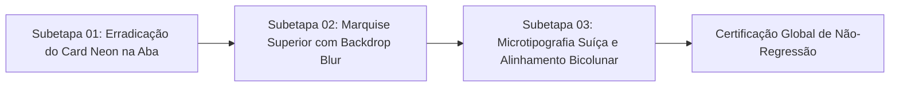

# Plano Geral: Refinamento Estético e Arquitetura de Precisão (BINMAX Avionics)

> **Engenheiro Chefe:** `tech-lead-orchestrator`  
> **Diretor Visual:** `chief-visual-director` (Skill `21-designer-senior-binmax`, `12-tokens-binmax`)  
> **Cirurgião Frontend:** `surgical-frontend-agent` (Skill `17-mudanca-cirurgica`)  
> **Auditor de Qualidade e Caos:** `qa-resilience-agent` (Skill `06-testing-quality`)  
> **Guardião de Regressão:** `regression-guardian-agent` (Skill `19-testes-de-regressao-visual`)

---

## 1. Diagnóstico Forense da Captura de Tela do Usuário

A análise milimétrica da captura de tela `media_1791698721274_e7ede4bf.png` evidenciou 4 problemas capitais que conferem aspecto amador e agressivo ("cassino barato"):

1. **Card Neon na Aba de Ativo:**
   - A aba ativa recebeu um fundo verde escuro (`#14251e`) com contorno verde em caixa fechada.
   - Isso quebra a linguagem de console de precisão e transforma a aba em um badge fluorescente agressivo.
   - **Correção:** A aba deve ter fundo institucional idêntico às demais superfícies (`#151922`), expressando o status exclusivamente no anel de 34px, no texto do PnL e na linha indicadora inferior de 2px.

2. **Concorrência entre a Pílula do Ativo e a Telemetria:**
   - No topo do gráfico, o botão `[ SYNTH_VOL_50 Turbo v (i) 🔔 ⭐ ]` consome 260px na esquerda, empurrando as 4 colunas de telemetria para a direita.
   - Como o ativo já está destacado na aba superior ativa, essa repetição volumosa esmaga a telemetria contra o futuro temporal do gráfico.
   - **Correção:** Ancoragem otimizada: a telemetria ganha prioridade e respira sem ser comprimida, com marquise óptica dedicada.

3. **Linha Dotted de Compra Slicing no PnL:**
   - A 4ª coluna de telemetria (`+$13.09 LUCRO APÓS A VENDA`) é cortada ao meio pela linha tracejada branca vertical de compra.
   - Além disso, os pavios de velas vermelhas sobem e passam diretamente atrás dos números porque a telemetria estava com fundo 100% transparente.
   - **Correção:** Superfície acetinada tática com backdrop blur de 16px e isolamento zIndex que atenua as linhas do gráfico e protege a leitura dos números.

4. **Tipografia Monolítica sem Proporção Áurea:**
   - O número `$100.00` está com peso tipográfico excessivo ("gordo"), e o rótulo `LUCRO APÓS A VENDA (L/P)` em linha única força a coluna a ter quase o dobro da largura das demais.
   - **Correção:** Tipografia Geist Mono SemiBold (peso 600, não ultra-black) e rótulos secundários organizados em duas linhas micro-tipográficas (9px, `#8A92A1`, tracking +0.06em), exatamente como na IQ Option oficial.

---

## 2. Divisão em Subetapas

- **Subetapa 01:** Limpeza do fundo e bordas da aba de ativo em `TerminalHeader.tsx`. Foco em elegância suíça sem contornos fluorescentes.
- **Subetapa 02:** Marquise óptica com proteção contra linhas de grade e pavios em `PriceChart.tsx`. Desobstrução do seletor in-chart.
- **Subetapa 03:** Grid bicolunar de 4 métricas, rótulos de 9px em duas linhas e tipografia Geist Mono refinada em `PriceChart.tsx`.
- **Homologação:** Execução de todas as suítes de testes de regressão, caos e performance.
