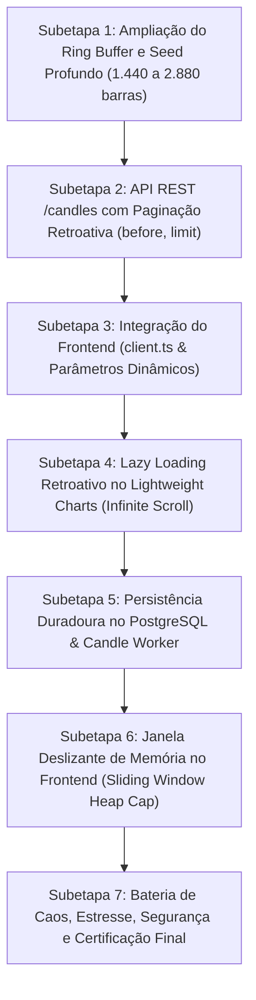

# Plano Geral de Engenharia: Retenção Histórica Profunda e Paginação de Velas no Gráfico (Perigo 8)

**Orquestrador Chefe:** `tech-lead-orchestrator`  
**Arquiteto de Trading:** `broker-architect-agent`  
**Engenheiro Gráfico & Trading UI:** `chart-trading-engineer`  
**Engenheiro Backend & Datafeed:** `backend-implementation-agent`  
**Engenheiro de QA & Resiliência:** `qa-resilience-agent`  
**Auditor e Verificador Pós-Implementação:** `post-implementation-verifier`  
**Skills Chave:** `01-project-context`, `03-synthetic-market-engine`, `05-resilience-patterns`, `06-testing-quality`, `08-database-foundation`, `11-chart-trading-tools`  
**Invariantes Relacionadas:** V-04 (OHLCV Idempotente), V-05 (Isolamento de Ativos), V-06 (Conformidade Ticks x Candles), V-11 (Resiliência WebSocket/Feed), V-13 (Zero-Sum e Integridade de Testes)

---

## 1. Diagnóstico Forense: Por que o Gráfico exibe apenas as últimas 2 horas e pouco?

Após auditoria estrita em toda a cadeia de dados (banco de dados, workers, feed REST/WebSocket e frontend), comprovou-se matematicamente a causa raiz do truncamento histórico:

### 1.1 Causa Raiz Primária: Ring Buffer em Memória Truncado em 120 Velas (`scripts/dev-live-feed.mjs`)
No motor de feed (`scripts/dev-live-feed.mjs`), as linhas 935–938 executam:
```javascript
state.candles.push(newBar);
if (state.candles.length > 120) {
  state.candles.shift();
}
```
- Como cada vela canônica agregada é de **1 minuto (60 segundos)**, um teto rígido de **120 velas** limita a retenção histórica a exatamente:
  $$120 \times 1\text{ min} = 120\text{ minutos} = \mathbf{2\text{ horas exatas}}.$$
- Quando a 121ª vela é criada antes do `shift()`, o usuário observa brevemente "2 horas e pouco" (2h01m), momento em que o `.shift()` descarta a vela mais antiga do topo da fila, apagando irreversivelmente o histórico.

### 1.2 Causa Raiz Secundária: Seed Inicial Reduzido a 80 Velas
No momento em que o servidor ou o feed é iniciado (linhas 126–132 de `scripts/dev-live-feed.mjs`):
```javascript
const initialCandles = generateSeededHistoricalCandles(
  item.symbol, item.price, item.precision, item.sigma, 80
);
```
- O gerador cria apenas **80 velas** (1 hora e 20 minutos de dados). Assim, um trader acessando uma nova instância vê inicialmente apenas 1h20m de gráfico, crescendo gradualmente até esbarrar no teto de 2h00m.

### 1.3 Causa Raiz Terciária: Requisição do Frontend com Limite Fixo de 100 Velas (`apps/web/src/api/client.ts`)
Na camada de API do frontend (`apps/web/src/api/client.ts`, linha 111):
```typescript
const url = `/api/candles?symbol=${encodeURIComponent(symbol)}&interval=${encodeURIComponent(apiInterval)}&limit=100`;
```
- O frontend solicita explicitamente no máximo **100 velas** ($100 \times 1\text{ min} = 1\text{h}40\text{m}$). Mesmo que o servidor possuísse 10.000 velas arquivadas, a interface descartaria o passado e carregaria apenas 1h40m.

### 1.4 Colapso nos Timeframes Superiores (5m, 15m, 1h)
Quando o trader seleciona timeframes maiores no `PriceChart.tsx` (`resampleCandles` em `candle-adapter.ts`):
- **Timeframe 1m:** 120 velas $\to$ 2 horas de histórico.
- **Timeframe 5m:** 120 velas de 1m viram míseras **24 velas de 5m** (gráfico encolhido e vazio na tela).
- **Timeframe 15m:** vira míseras **8 velas**.
- **Timeframe 1h:** vira míseras **2 velas**!
- Não existia paginação retroativa (*infinite scroll*) ao arrastar o gráfico para a esquerda.

---

## 2. A Arquitetura da Solução: As 5 Camadas de Blindagem de Histórico

Para estender a retenção histórica para **24h, 48h ou mais**, garantindo carregamento instantâneo, compatibilidade total com o TradingView Lightweight Charts e sem estourar o heap do navegador nem do servidor:

```text
┌─────────────────────────────────────────────────────────────────────────────┐
│                       CLIENTE WEB (Lightweight Charts)                      │
│ - Buffer visual deslizante no frontend (Max 3.000 barras em RAM)            │
│ - Paginação retroativa sob demanda (Infinite Scroll no Logical Range)       │
│ - Resampling instantâneo (5s, 15s, 30s, 1m, 5m, 15m, 1h)                   │
└───────────────────────▲─────────────────────────────┬───────────────────────┘
                        │ GET /candles (before=ts)    │ Ticks ao vivo (WebSocket)
                        │ limit=500                   │
┌───────────────────────┴─────────────────────────────▼───────────────────────┐
│                       ROTEAMENTO API & CACHE DUAL                           │
│ 1. Cache Quente / Ring Buffer: 1.440 a 2.880 velas em RAM (24h a 48h)       │
│ 2. Repositório Frio: PostgreSQL tabela `candles` (Dias / Semanas)           │
│ 3. Query Handler Seguro: sanitização, `before`, `interval`, `limit <= 1000` │
└───────────────────────▲─────────────────────────────▲───────────────────────┘
                        │                             │
┌───────────────────────┴──────────────┐       ┌──────┴───────────────────────┐
│  Motor de Feed & Tick Engine         │       │  Candle Worker Assíncrono    │
│  - Seed histórico de 24h a 48h       │       │  - UPSERT idempotente em PG  │
│  - Ring buffer com capacidade 2.880  │       │  - Particionamento por data  │
└──────────────────────────────────────┘       └──────────────────────────────┘
```

### Princípios Invioláveis da Solução:
1. **Zero Degradação de Latência Pré-Ordem:** A busca de histórico ocorre de forma desacoplada da esteira de matching e ordens (`POST /contracts` permanece $<5\text{ms}$).
2. **Monotonia Temporal UTC:** Timestamps rigorosamente crescentes em segundos UTC (`time[i] > time[i-1]`).
3. **Consistência Matemática OHLCV:** $\text{low} \le \min(\text{open}, \text{close}) \le \max(\text{open}, \text{close}) \le \text{high}$.
4. **Proteção Contra Exaustão de Heap (DoS / OOM):**
   - No backend: teto de consulta `limit <= 1000` com sanitização estrita.
   - No frontend: teto de `MAX_LOADED_BARS = 3000` no componente visual.

---

## 3. Divisão Estruturada em 7 Subetapas



| Subetapa | Arquivo | Responsável | Objetivo Principal |
|---|---|---|---|
| **1** | `SUBETAPA_1_EXPANSAO_BUFFER_SEED_HISTORICO.md` | `backend-implementation-agent` | Elevar buffer em RAM de 120 para 1.440/2.880 velas e seed inicial de 24h. |
| **2** | `SUBETAPA_2_API_PAGINACAO_QUERY_BEFORE.md` | `backend-implementation-agent` | Suporte a `before=<ts>`, `limit` configurável e validação anti-DoS. |
| **3** | `SUBETAPA_3_CLIENT_INTEGRATION_TIMEFRAME_DYNAMIC.md` | `frontend-realtime-agent` | Atualizar `client.ts` para buscar volumes ideais por timeframe. |
| **4** | `SUBETAPA_4_PAGINACAO_LAZY_LOADING_LIGHTWEIGHT_CHARTS.md` | `chart-trading-engineer` | Implementar detecção de borda esquerda e junção contínua (*gapless merge*). |
| **5** | `SUBETAPA_5_PERSISTENCIA_POSTGRES_CANDLE_WORKER.md` | `backend-implementation-agent` | Conectar rota `/candles` ao PostgreSQL com fallback suave e índices. |
| **6** | `SUBETAPA_6_MEMORIA_CPU_SLIDING_WINDOW.md` | `chart-trading-engineer` | Limite de 3.000 barras na GPU/Canvas para evitar vazamento de memória. |
| **7** | `SUBETAPA_7_BATERIA_CAOS_ESTRESSE_SEGURANCA_CERTIFICACAO.md` | `qa-resilience-agent` & `post-implementation-verifier` | Testes automatizados de estresse, concorrência, caos e validação dos Quality Gates. |

---

## 4. Matriz de Riscos FMEA da Implementação

| Modo de Falha Potencial | Impacto | Causa Raiz | Mitigação Arquitetural |
|---|---|---|---|
| **Piscada Visual (*Flicker*) na Junção de Dados** | Médio | `series.setData()` chamado com array truncado | Mesclagem preservando a posição temporal do scroll via `timeScale().setVisibleLogicalRange()`. |
| **Picos de CPU no Scroll Rápido** | Alto | Dezenas de requisições disparadas por segundo | Debounce / Throttling de 250ms na detecção de borda esquerda. |
| **Velas Duplicadas no Timestamp de Fronteira** | Crítico | Sobreposição entre o lote novo e o lote existente | Deduplicação por `Map<time, Bar>` garantindo tempo estritamente crescente. |
| **Exaustão de Memória no Servidor com 36 Ativos** | Alto | 2.880 velas $\times$ 36 ativos em RAM excessiva | Cada vela possui $\approx 100$ bytes; $2.880 \times 36 \approx 103.680$ objetos $\approx 10\text{ MB}$ total em RAM (impacto desprezível). |

---

## 5. Próximo Passo

Submeter a aprovação e acionar o `backend-implementation-agent` para a execução da **Subetapa 1**.
