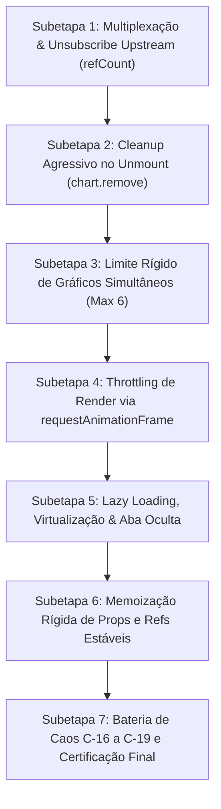

# Plano Geral — Blindagem de Memória e CPU no Frontend (N Charts = N Listeners)

> **Documento:** `docs/fase-1/frontend-memory-cpu-hardening/00-PLANO-GERAL.md`  
> **Status:** APROVADO PELO TECH LEAD & BROKER ARCHITECT  
> **Classificação:** Crítico — Resiliência de Interface, Prevenção de Memory Leaks e Eficiência de Renderização  
> **Invariantes Relacionadas:** V-05 (Isolamento de Ativos), V-11 (1 Conexão WS por Aba / Max 10 Assinaturas), V-13 (Zero-Sum Ledger)

---

## 1. Diagnóstico do Problema & Causa Raiz

Em plataformas de trading multi-gráficos (Multi-Chart Grid), cada instância de gráfico (ex: Lightweight Charts / TradingView) consome recursos de GPU (WebGL/Canvas), listeners de WebSocket, histórico em memória (estruturas de velas) e agendamento de renders.

### O Problema do Jeito Ingênuo:
Se implementado sem as salvaguardas adequadas:
1. **N Conexões / N Listeners:** Cada gráfico abre seu próprio socket ou registra múltiplos listeners independentes. Ao trocar de par ou fechar células, os listeners anteriores não são removidos, causando vazamento cumulativo de memória (heap exhaustion).
2. **Render Sem Throttling:** Cada tick individual (que pode chegar a 10-20 ticks/s em volatilidade alta) dispara `setTick`, `setSentiment` e `series.update()` imediatamente no React. Multiplicado por 4 ou 6 gráficos, o navegador tenta executar centenas de redesenhos por segundo, congelando a thread principal do JavaScript (jank / UI lock).
3. **Falta de Teto Institucional:** O usuário pode abrir dezenas de gráficos simultaneamente, estourando a cota de contextos Canvas do Chrome (limite de 16 contextos 2D ativos) e forçando a aba a crashar ("Aw, Snap!").
4. **Desperdício em Gráficos Ocultos:** Gráficos fora do campo de visão ou em abas em segundo plano continuam forçando cálculos de Canvas.

---

## 2. A Solução: As 6 Técnicas Combinadas da Indústria

| Técnica | Objetivo | Implementação |
| :--- | :--- | :--- |
| **1. Multiplexação & Unsubscribe Upstream** | 1 WebSocket único para todos os gráficos com cancelamento reativo no upstream quando o símbolo não tiver mais espectadores. | `TradingFeedManager.ts` com contagem de referências (`refCount`). Quando `refCount == 0`, envia `{ type: "unsubscribe", symbol }` para o gateway. |
| **2. Cleanup Agressivo no Unmount** | Destruição determinística de instâncias ao fechar ou trocar de layout. | Desmonte com `chart.remove()`, cancelamento de `ResizeObserver`, desvinculação de `PriceLine`s e cancelamento de queries ativas no TanStack Query. |
| **3. Limite de Gráficos Simultâneos** | Prevenir exaustão de contextos Canvas e sobrecarga de CPU. | Teto rígido `MAX_CHARTS = 6` na UI da grade com alerta não-bloqueante e feedback visual claro. |
| **4. Throttling de Render (requestAnimationFrame)** | Limitar a renderização à taxa de atualização do monitor (60fps). | Hook `useRafChartUpdater`: agrupa múltiplos ticks que chegam na mesma fração de segundo e faz um único `series.update()` no frame seguinte da GPU. |
| **5. Lazy Loading & Virtualização** | Pausar gráficos invisíveis ou em abas minimizadas. | `IntersectionObserver` e `document.visibilityState`: se o gráfico estiver fora da viewport, suspende o redesenho até voltar à cena. |
| **6. Memoização Rígida & Refs Estáveis** | Eliminar re-renders parasitas no React. | `useMemo`, `useCallback`, `useRef` para instâncias do Lightweight Charts e isolamento de estados secundários (como sentimentos de mercado). |

---

## 3. Divisão em 7 Subetapas de Implementação

1. **Subetapa 1 (`SUBETAPA_1_MULTIPLEXACAO_UNSUB_UPSTREAM.md`)**:
   - `TradingFeedManager.ts`: Ref counting por símbolo e envio de `{ type: "unsubscribe", symbol }`.
   - Teste: `tests/test-subetapa-1-fe-multiplex-unsub.mjs`.

2. **Subetapa 2 (`SUBETAPA_2_CLEANUP_AGRESSIVO_UNMOUNT.md`)**:
   - Desmonte total no `PriceChart.tsx` e cancelamento de queries no `GridCell`.
   - Teste: `tests/test-subetapa-2-fe-aggressive-cleanup.mjs`.

3. **Subetapa 3 (`SUBETAPA_3_LIMITE_CHARTS_SIMULTANEOS.md`)**:
   - Teto `MAX_CHARTS = 6`, suporte a layout expandido e bloqueio com aviso institucional.
   - Teste: `tests/test-subetapa-3-fe-max-charts-limit.mjs`.

4. **Subetapa 4 (`SUBETAPA_4_RAF_RENDER_THROTTLING.md`)**:
   - Hook / Utilitário de coalescing rAF a 60fps no `PriceChart.tsx`.
   - Teste: `tests/test-subetapa-4-fe-raf-throttling.mjs`.

5. **Subetapa 5 (`SUBETAPA_5_LAZY_LOADING_VIRTUALIZACAO.md`)**:
   - Pausa de gráficos fora de visão e sob aba minimizada.
   - Teste: `tests/test-subetapa-5-fe-lazy-virtualization.mjs`.

6. **Subetapa 6 (`SUBETAPA_6_MEMOIZACAO_REFS_ESTAVEIS.md`)**:
   - Memoização estrita de props e isolamento de re-renders de tick.
   - Teste: `tests/test-subetapa-6-fe-memo-refs-stability.mjs`.

7. **Subetapa 7 (`SUBETAPA_7_CAOS_PERFORMANCE_CERTIFICACAO.md`)**:
   - Testes de caos C-16 a C-19, teste de estresse de memória e certificação formal.
   - Teste: `tests/test-subetapa-7-fe-memory-caos.mjs`.

---

## 4. Critérios de Homologação dos Quality Gates

Cada subetapa é acompanhada de teste automatizado dedicado. A transição para a próxima subetapa é bloqueada se qualquer teste falhar ou se houver regressão em relação às garantias financeiras e de performance V-01 a V-13.
