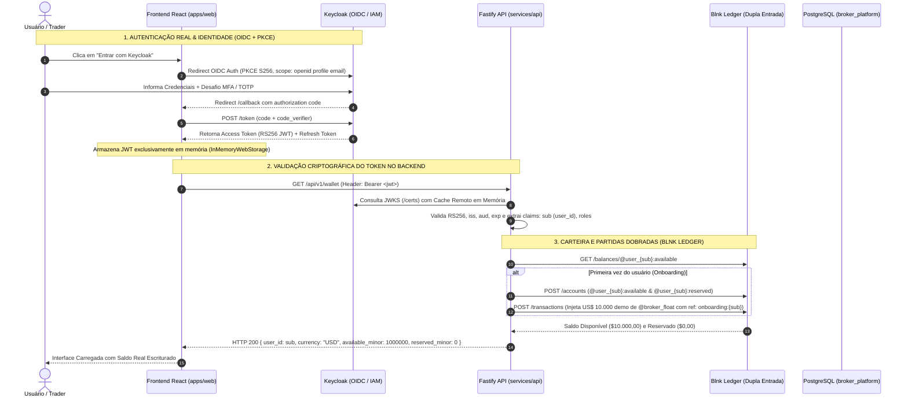

# Plano Geral: Login Real com Keycloak (OIDC/PKCE/MFA) & Carteira Ledger com Blnk (Partidas Dobradas)

**Status:** APROVADO  
**Responsável Técnico:** `tech-lead-orchestrator`  
**Especialistas:** `security-reviewer`, `financial-correctness-reviewer`, `backend-implementation-agent`, `frontend-realtime-agent`, `qa-resilience-agent`, `post-implementation-verifier`  
**Skills Chave:** `01-project-context`, `02-financial-invariants`, `04-security-iam`, `05-resilience-patterns`, `06-testing-quality`, `08-database-foundation`, `10-post-implementation-verification`

---

## 1. Visão Executiva & Arquitetura de Ponta a Ponta

O ecossistema oficial opera com separação estrita de responsabilidades entre **Identidade (Keycloak)** e **Finanças/Balanço (Blnk Ledger)**:

---

## 2. Pilares Arquiteturais Invioláveis

### A. Identidade & Segurança (S-01 a S-06)
1. **Fluxo OIDC PKCE S256 Obrigatório (S-01):** Proibido Implicit Flow ou Direct Access Grants. Tokens mantidos exclusivamente na memória RAM da aplicação (`InMemoryWebStorage`). Zero persistência de access token em `localStorage` ou `sessionStorage`.
2. **Validação Estrita de JWT (S-02):** Chaves públicas obtidas exclusivamente do JWKS do Keycloak. Rejeição sumária de tokens não assinados (`alg: none`) ou assinados com algoritmos simétricos não permitidos. Algoritmo travado em `RS256`.
3. **RBAC por Realm Roles (S-03):** Permissões extraídas de `realm_access.roles`. Negar por padrão. Rotas administrativas exigem role `ADMIN` ou `AUDITOR`.
4. **Proteção BOLA/IDOR (S-04):** O `user_id` nunca é aceito via URL, query param ou corpo da requisição. Toda query filtra obrigatoriamente por `WHERE user_id = :sub`. Tentativas de acesso a recursos alheios retornam `404 Not Found` (não revelando a existência do recurso).
5. **Prevenção de Mass Assignment (S-05):** Schemas de validação estritos com Zod (`zod.strict()`). Rejeição de campos extras como `balance`, `payout`, `status`, `role`.

### B. Invariantes Financeiras & Blnk Ledger (I-01 a I-06)
1. **Ledger Append-Only Inviolável (I-01):** Saldo só existe como histórico de transações no Blnk. É proibido qualquer comando `UPDATE ... SET balance = ...`.
2. **Partidas Dobradas & Equação de Soma Zero (I-02):** Toda transação possui `source` e `destination`. A soma de todos os débitos é rigorosamente igual à soma de todos os créditos.
3. **Idempotência Absoluta (I-03):** 
   - Onboarding: `onboarding:{sub}`
   - Reserva de ordem: `reserve:{contract_id}`
   - Liquidação: `settlement:{contract_id}`
   - Payout WIN: `payout:{contract_id}`
   - Reversão: `reversal:{tx_ref}`
4. **Precisão Inteira em Centavos (D-18):** Toda representação monetária é um número inteiro na menor fração (`*_minor`). Centavos de USD. Proibição absoluta de tipos de ponto flutuante (`float`, `double`).
5. **Isolamento de Contas:** Cada usuário possui conta disponível (`@user_{sub}:available`) e conta de garantia (`@user_{sub}:reserved`).

---

## 3. Matriz de Subetapas de Implementação

| Subetapa | Escopo Técnico | Documento |
| :--- | :--- | :--- |
| **Subetapa 1** | Configuração do Keycloak: Realm `broker-demo`, Client `broker-web`, PKCE S256, MFA/TOTP, RBAC Roles | [`SUBETAPA_1_KEYCLOAK_OIDC_PKCE_MFA.md`](./SUBETAPA_1_KEYCLOAK_OIDC_PKCE_MFA.md) |
| **Subetapa 2** | Backend Fastify Auth: Plugin JWKS RS256, extração segura de `sub`, guard de RBAC e barreira BOLA/IDOR | [`SUBETAPA_2_FASTIFY_AUTH_JWKS_RBAC_BOLA.md`](./SUBETAPA_2_FASTIFY_AUTH_JWKS_RBAC_BOLA.md) |
| **Subetapa 3** | Blnk Ledger Onboarding: Inicialização do ledger, contas do usuário, crédito seed inicial e idempotência | [`SUBETAPA_3_BLNK_DOUBLE_ENTRY_ONBOARDING.md`](./SUBETAPA_3_BLNK_DOUBLE_ENTRY_ONBOARDING.md) |
| **Subetapa 4** | Ciclo Financeiro de Trading: Reserva na abertura, liquidação WIN/LOSS/DRAW e equação de soma zero | [`SUBETAPA_4_CICLO_TRADING_LEDGER_SOMA_ZERO.md`](./SUBETAPA_4_CICLO_TRADING_LEDGER_SOMA_ZERO.md) |
| **Subetapa 5** | Resiliência, Circuit Breaker e Caos: Tolerância a quedas do Keycloak e Blnk com degradação segura | [`SUBETAPA_5_RESILIENCIA_CHAOS_KEYCLOAK_BLNK.md`](./SUBETAPA_5_RESILIENCIA_CHAOS_KEYCLOAK_BLNK.md) |
| **Subetapa 6** | Certificação Final: Bateria de testes de estresse, segurança contra forjamento de tokens e auditoria V-01 a V-13 | [`SUBETAPA_6_CERTIFICACAO_TESTES_E2E_HOMOLOGACAO.md`](./SUBETAPA_6_CERTIFICACAO_TESTES_E2E_HOMOLOGACAO.md) |

---

## 4. Critérios de Homologação de Cada Gate
Nenhuma subetapa avança sem:
1. Código revisado pelos especialistas (`security-reviewer` e `financial-correctness-reviewer`).
2. Teste automatizado executável com zero falhas.
3. Prova matemática de não-regressão das funcionalidades existentes.
