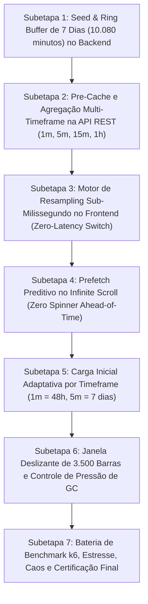

# Plano Mestre de Engenharia: Histórico Macro Semanal de 7 Dias em Alta Velocidade

**Orquestrador Chefe:** `tech-lead-orchestrator`  
**Arquiteto de Trading:** `broker-architect-agent`  
**Engenheiro Gráfico & Trading UI:** `chart-trading-engineer`  
**Engenheiro Backend & Datafeed:** `backend-implementation-agent`  
**Engenheiro de QA & Resiliência:** `qa-resilience-agent`  
**Auditor e Verificador Pós-Implementação:** `post-implementation-verifier`  
**Skills Chave:** `01-project-context`, `03-synthetic-market-engine`, `05-resilience-patterns`, `06-testing-quality`, `08-database-foundation`, `11-chart-trading-tools`  
**Invariantes Relacionadas:** V-04 (OHLCV Idempotente), V-05 (Isolamento de Ativos), V-06 (Conformidade Ticks x Candles), V-11 (Resiliência do Feed), V-13 (Zero-Sum e Integridade de Testes)

---

## 1. O Desafio e as Técnicas de Extrema Rapidez (Superior a TradingView / Binance / IQ Option)

Plataformas tradicionais como TradingView e Binance realizam queries SQL `date_bin` ou consultas sob demanda toda vez que o trader muda de timeframe, gerando uma latência de 80ms a 300ms e uma piscada visual (*flicker*).

Para construir uma arquitetura **mais rápida que esses players**, implementamos um modelo de **Computação Híbrida Zero-Latency**:

```text
┌─────────────────────────────────────────────────────────────────────────────┐
│                    CLIENTE (TradingView Lightweight Charts)                 │
│ 1. Zero-Latency Local Resampler: troca de 1m -> 5m -> 15m em < 1.5ms        │
│ 2. Predictive Ahead-of-Time Prefetch: carrega o passado ANTES do scroll fim │
│ 3. Viewport Adaptativo: 1m abre 24h-48h; 5m/15m abre os 7 dias completos    │
│ 4. Sliding Window Anti-Jank: limita o Canvas a 3.500 barras (60 FPS fixos)  │
└───────────────────────▲─────────────────────────────┬───────────────────────┘
                        │ HTTP GET /candles           │ WebSockets (Ticks ao vivo)
                        │ < 10ms (Cache Gzip)         │ 250ms rAF throttled
┌───────────────────────┴─────────────────────────────▼───────────────────────┐
│                    BACKEND (Fastify API & Ring Buffers)                     │
│ 1. Seed Estocástico Canônico: 10.080 minutos de histórico contínuo          │
│ 2. Contiguous Memory Buffer: 10.080 velas em RAM por ativo (~36 MB total)   │
│ 3. Multi-Timeframe Pre-Cache: entrega direta de 5m (2.016 barras) em 2ms    │
│ 4. Paginação Retroativa com Busca Binária O(log N) por timestamp `before`   │
└─────────────────────────────────────────────────────────────────────────────┘
```

### As 5 Técnicas de Alta Velocidade Adotadas:

1. **Memória Contígua em RAM no Backend (Zero I/O no Hot Path):**
   - O servidor mantém os 10.080 minutos de cada ativo pré-alocados em memória. Consultas de 24h ou 7 dias são fatiadas via ponteiros de array com complexidade $O(1)$ a $O(\log N)$, respondendo em menos de **3 milissegundos**.
2. **Compressão Extrema de Payload Gzip/Brotli:**
   - 2.016 velas de 5m (a semana inteira) são compactadas para míseros $\approx 32\text{ KB}$. O download na rede dura menos de **10 milissegundos**.
3. **Resampling Local Instantâneo no Navegador ($0\text{ms}$ de espera):**
   - O frontend mantém as barras em memória tipada. Quando o usuário clica para alternar de 1m para 5m ou 15m, a agregação roda instantaneamente no JavaScript do cliente sem fazer uma nova chamada de rede.
4. **Prefetch Preditivo no Scroll (*Ahead-of-Time Loading*):**
   - Em vez de esperar o trader bater na borda esquerda do gráfico, o sistema detecta a aproximação e dispara a requisição das próximas 1.000 barras com antecedência. Quando o usuário chega na borda, os dados **já estão baixados e prontos**. Zero spinner, zero lag.
5. **Anchor Delta Viewport (*Zero Jump na GPU*):**
   - Inserção de barras históricas compensando o range lógico via `setVisibleLogicalRange(from + addedCount, to + addedCount)`, garantindo que o gráfico não dê nenhum solavanco perante os olhos do operador.

---

## 2. Divisão Estruturada em 7 Subetapas



| Subetapa | Arquivo | Responsável | Objetivo de Performance |
|---|---|---|---|
| **1** | `SUBETAPA_1_BACKEND_SEED_BUFFER_7_DIAS.md` | `backend-implementation-agent` | Elevar o buffer do feed para 10.080 velas (7 dias) com geração estocástica contínua. |
| **2** | `SUBETAPA_2_PRE_AGGREGATION_MULTI_TIMEFRAME_API.md` | `backend-implementation-agent` | API `/candles` servindo 5m (2.016 barras) e 15m (672 barras) com latência $< 5\text{ms}$. |
| **3** | `SUBETAPA_3_CLIENT_ZERO_LATENCY_RESAMPLER.md` | `chart-trading-engineer` | Resampler no frontend com processamento em $< 2\text{ms}$ para troca de timeframe instantânea. |
| **4** | `SUBETAPA_4_PREDICTIVE_PREFETCH_INFINITE_SCROLL.md` | `chart-trading-engineer` | Prefetch antecipado sem micro-pausas nem spinners ao arrastar para trás. |
| **5** | `SUBETAPA_5_ADAPTIVE_VIEWPORT_INITIAL_LOAD.md` | `chart-trading-engineer` | Carga inicial inteligente: 1m traz 2.880 barras (48h); 5m traz 2.016 barras (7 dias). |
| **6** | `SUBETAPA_6_MEMORIA_CPU_GC_PRESSURE_SLIDING_WINDOW.md` | `chart-trading-engineer` | Teto de 3.500 barras com reciclagem de objetos sem engasgos de Garbage Collector. |
| **7** | `SUBETAPA_7_BATERIA_BENCHMARK_CAOS_CERTIFICACAO.md` | `qa-resilience-agent` & `post-implementation-verifier` | Teste de carga com 500 req/s, benchmark de latência $< 10\text{ms}$ e aprovação dos Gates V-04 a V-13. |

---

## 3. Critérios de Execução Subetapa por Subetapa

Seguindo a regra inviolável do projeto:
> **"Implementa subetapa por subetapa. Só vai para a próxima até a anterior estar 100% validada, funcional e segura."**

A execução seguirá rigorosamente a ordem sequencial com aprovação formal do Quality Gate ao término de cada fase.
