# PLANO GERAL: PLATAFORMA DE ÍNDICES SINTÉTICOS — FASE 2

**Orquestrador Chefe:** `tech-lead-orchestrator`  
**Data:** 08/10/2026  
**Status do Projeto:** Início da Fase 2 — Expansão Regional (6 Países, 2 Idiomas, 6 Moedas, Geoblocking, Feature Flags, Feed OTC Real Demo, Schemas Preparatórios de KYC e Pagamentos).

---

## 1. Escopo Formal da Fase 2

### 1.1 Incluído no Escopo
1. **6 Países**: Brasil (`BR`), México (`MX`), Colômbia (`CO`), Argentina (`AR`), Chile (`CL`), Peru (`PE`).
2. **2 Idiomas**: Português (`pt-BR`) e Espanhol (`es-ES`, `es-419` / `es-*`).
3. **6 Moedas de Exibição**: `BRL` (R$), `MXN` (Mex$), `COP` (Col$), `ARS` (Arg$), `CLP` (CLP$), `PEN` (S/.).
4. **Índices Sintéticos Próprios**: Continuidade dos índices sintéticos nativos da Fase 1 operados pelo Tick Engine via CSPRNG.
5. **OTC Demo com Feed de Mercado Real**: Ativos demo vinculados a dados de mercado real para:
   - `BTC/USD (OTC)` (`BTCUSD_OTC`)
   - `ETH/USD (OTC)` (`ETHUSD_OTC`)
   - `EUR/USD (OTC)` (`EURUSD_OTC`)
   - `XAU/USD (OTC)` (`XAUUSD_OTC`)
6. **Carteira Demo por Usuário**: Mantida em `USD_minor` (centavos de USD) como fonte de verdade inviolável no Blnk Ledger, com conversão unicamente na camada de apresentação (Display Currency).
7. **Contratos UP/DOWN com Expiração Fixa**: Preservação das regras de 60s/timeframes fixos e payout da Fase 1.
8. **Ledger de Dupla Entrada (Demo)**: Blnk Ledger preservado com partidas dobradas, soma zero e idempotência.
9. **Painel Admin Multi-País**: Gestão por país, controle de flags em tempo real, visualização de tráfego regional e status de conformidade.
10. **Geoblocking por País**: Bloqueio na borda/API de requisições originadas fora dos 6 países autorizados (retornando HTTP 403 `GEO_BLOCKED`), com proteção rigorosa contra spoofing de IP e headers forjados.
11. **Feature Flags por País**: Sistema dinâmico em Redis + PostgreSQL para ligar/desligar países ou funcionalidades específicas em tempo real sem necessidade de novo deploy.
12. **Monitoramento e Alertas**: Métricas segmentadas por país no Prometheus (volume de requests, bloqueios de geoblocking, latência, erros) e alertas no Alertmanager/Grafana.
13. **Preparação de Schema para KYC e Pagamentos Futuros**: Modelagem no PostgreSQL de tabelas e campos para identificadores fiscais/civis por país (ex.: CPF, CURP, CC, DNI, RUT) e estrutura preparatória de métodos de pagamento futuros (PIX, SPEI, PSE, etc.), sem tráfego de dinheiro real e sem acionamento de PSP.

### 1.2 Fora do Escopo da Fase 2
- Depósitos e saques reais.
- KYC completo obrigatório com envio de documentos/selfies e biometria facial.
- Integração ativa de PSP (Payment Service Provider) em produção.
- Circulação de qualquer valor em dinheiro real.
- Obtenção de licenciamento financeiro e compliance bancário ao vivo.

### 1.3 Critério de Pronto da Fase 2
A Fase 2 será considerada homologada e pronta quando:
1. Usuários dos 6 países (`BR`, `MX`, `CO`, `AR`, `CL`, `PE`) acessam a plataforma normalmente.
2. Os 2 idiomas (`pt-BR` e `es-*`) funcionam corretamente e comutáveis sem recarregamento destrutivo de estado.
3. As 6 moedas de exibição formatam valores e saldos com precisão e símbolos regionais adequados, mantendo integridade com o saldo demo em USD.
4. O feed OTC demo com dados reais de mercado para `BTC`, `ETH`, `EUR/USD` e `XAU/USD` opera em todos os 6 países sem latência excessiva ou descontinuidade.
5. O Geoblocking bloqueia 100% das origens de países não autorizados com resposta controlada e segura.
6. As Feature Flags ativam ou desativam o acesso ou recursos de qualquer país em runtime (< 100ms) sem necessidade de deploy.
7. Nenhum dinheiro real circula (100% demo, validado contavelmente no Blnk Ledger).
8. A bateria de testes de estresse, segurança e injeção de caos é executada e aprovada com 100% de sucesso.

---

## 2. Seleção e Atribuição do Pool de Agentes Especializados

Em estrita consonância com [AGENTS.md](../../AGENTS.md) e as skills operacionais do projeto, selecionamos o seguinte pool de agentes para a Fase 2:

| Agente | Tipo / Permissão | Responsabilidades Primárias na Fase 2 | Skills Mobilizadas |
| :--- | :--- | :--- | :--- |
| **`broker-architect-agent`** | `architecture-design` / `write-code` | - Arquitetura do conector de dados reais de mercado para OTC demo. - Arquitetura do barramento de Feature Flags e Geoblocking com cache atômico no Redis. - Modelagem do desacoplamento entre moeda base USD (Ledger) e moedas de exibição regionais. | `01`, `02`, `03`, `05`, `08`, `09` |
| **`backend-implementation-agent`** | `write-code` (`services/**`, `db/**`) | - Migrations do PostgreSQL para países, moedas, feature flags, e schemas preparatórios de KYC/pagamentos. - Middleware de Geoblocking e resolução confiável de IP/país. - Engine de Feature Flags por país com cache Redis. - Serviço de taxas de câmbio para exibição (`display-currency`). - Conector e adapter de feed real para OTC demo (BTC, ETH, EUR/USD, XAU/USD). | `01`, `03`, `04`, `05`, `08` |
| **`frontend-realtime-agent`** | `write-code` (`apps/web/**`, `apps/admin/**`) | - Internacionalização (i18n) em `pt-BR` e `es-*`. - Seletor dinâmico de país, idioma e moeda de exibição. - Formatador monetário regional das 6 moedas (`Intl.NumberFormat`). - Telas de bloqueio por país (Geoblocked Screen) e fallback gracioso. - Painel Admin Multi-País com controles de Feature Flags em tempo real e visualização operacional. | `01`, `03`, `04` |
| **`chart-trading-engineer`** | `write-code` (`apps/web/src/chart/**`) | - Suporte no Lightweight Charts aos feeds de mercado real dos 4 pares OTC (`BTCUSD_OTC`, `ETHUSD_OTC`, `EURUSD_OTC`, `XAUUSD_OTC`). - Garantia de precisão decimal adaptativa por par. - Manutenção de taxa estável de 60 FPS e ausência de travamentos. | `01`, `03`, `06`, `11` |
| **`financial-correctness-reviewer`** | `read-only` estrito | - Auditoria inviolável das invariantes `I-01` a `I-06`. - Garantia matemática de que moedas de exibição NÃO afetam o saldo contábil ou settlement (Ledger permanece 100% `USD_minor`). - Certificação de isolamento entre demo e qualquer estrutura de pagamento. | `01`, `02`, `05`, `08`, `09` |
| **`security-reviewer`** | `read-only` estrito | - Auditoria das regras `S-01` a `S-06`. - Testes anti-spoofing em cabeçalhos de geolocalização (`X-Forwarded-For`, `CF-IPCountry`). - Auditoria RBAC das rotas do Painel Admin Multi-País. - Validação de BOLA/IDOR na consulta e alteração de flags. | `01`, `04`, `08`, `09` |
| **`qa-resilience-agent`** | `write-tests-only` (`tests/**`) | - Criação e execução de testes unitários e de integração multi-país. - Bateria de testes de estresse e carga k6 simulando tráfego dos 6 países simultâneos. - Testes de injeção de caos (queda de Redis, flap de flags em tempo real, jitter de feed OTC). | `01`, `05`, `06`, `07`, `08`, `09` |
| **`post-implementation-verifier`** | `read-only` estrito | - Verificação independente e formal de cada Quality Gate. - Execução e ateste das garantias `V-01` a `V-13` estendidas para as novas estruturas. - Emissão do veredito final antes de autorizar o avanço para a etapa seguinte. | `01`, `02`, `03`, `06`, `08`, `09`, `10` |

---

## 3. Divisão do Plano em Subetapas Completas

A execução da Fase 2 está rigorosamente dividida em **8 Subetapas Sequenciais**. Nenhuma subetapa será iniciada sem que a anterior esteja 100% implementada, testada e homologada pelo `post-implementation-verifier`.

```mermaid
flowchart TD
    S1["Subetapa 1: Schemas de Países, Flags, KYC & Pagamentos Preparatórios"] --> G1{"Gate 1 Homologado?"}
    G1 -- Sim --> S2["Subetapa 2: Motor de Geoblocking & Feature Flags Engine (Backend)"]
    G1 -- Não --> S1
    S2 --> G2{"Gate 2 Homologado?"}
    G2 -- Sim --> S3["Subetapa 3: Motor Multi-Moeda de Exibição & Câmbio de Referência"]
    G2 -- Não --> S2
    S3 --> G3{"Gate 3 Homologado?"}
    G3 -- Sim --> S4["Subetapa 4: Conector & Adapter de Feed Real para OTC Demo"]
    G3 -- Não --> S3
    S4 --> G4{"Gate 4 Homologado?"}
    G4 -- Sim --> S5["Subetapa 5: Painel Admin Multi-País & Gestão de Flags em Runtime"]
    G4 -- Não --> S4
    S5 --> G5{"Gate 5 Homologado?"}
    G5 -- Sim --> S6["Subetapa 6: Frontend i18n, Localização Regional & Experiência Multi-País"]
    G5 -- Não --> S5
    S6 --> G6{"Gate 6 Homologado?"}
    G6 -- Sim --> S7["Subetapa 7: Monitoramento Prometheus, Métricas e Alertas Regionais"]
    G6 -- Não --> S6
    S7 --> G7{"Gate 7 Homologado?"}
    G7 -- Sim --> S8["Subetapa 8: Bateria Completa de Carga k6, Caos e Certificação Final"]
    G7 -- Não --> S7
    S8 --> G8{"Critérios de Pronto Atingidos?"}
    G8 -- Sim --> DONE["🎉 FASE 2 100% HOMOLOGADA E PRONTA"]
```

### Resumo dos Documentos de Detalhamento:
1. `docs/fase-2/SUBETAPA_1_SCHEMA_KYC_PAGAMENTOS_E_PAISES.md`
2. `docs/fase-2/SUBETAPA_2_GEOBLOCKING_E_FEATURE_FLAGS_ENGINE.md`
3. `docs/fase-2/SUBETAPA_3_I18N_E_MULTI_CURRENCY_DISPLAY_ENGINE.md`
4. `docs/fase-2/SUBETAPA_4_OTC_REAL_MARKET_FEED_ADAPTER.md`
5. `docs/fase-2/SUBETAPA_5_ADMIN_PANEL_MULTI_COUNTRY.md`
6. `docs/fase-2/SUBETAPA_6_FRONTEND_LOCALIZATION_E_GEO_EXPERIENCE.md`
7. `docs/fase-2/SUBETAPA_7_MONITORAMENTO_PROMETHEUS_ALERTAS_POR_PAIS.md`
8. `docs/fase-2/SUBETAPA_8_BATERIA_INTEGRACAO_ESTRESSE_CAOS_CERTIFICACAO.md`

---

## 4. Regras Invioláveis de Execução e Quality Gates

1. **Execução Isolada e Sequencial**: Uma única subetapa por vez. É estritamente proibido iniciar a subetapa $N+1$ antes da subetapa $N$ estar com todos os testes verdes e verificados.
2. **Sem Suposições ou Alucinações**: Caso falte qualquer parâmetro de infraestrutura, chave ou endpoint externo, registrar expressamente `INFORMAÇÃO AUSENTE` e utilizar mocks seguros ou especificações acordadas.
3. **Invariante Contábil I-01 / I-02 (Zero Dinheiro Real)**: Toda a contabilidade do sistema permanece demo em centavos de dólar (`USD_minor`). Nenhuma transação financeira em moeda fiduciária real é permitida. As 6 moedas são estritamente de visualização calculadas no client/BFF a partir de tabelas de câmbio de referência.
4. **Resiliência e Caos Obrigatórios**: Toda funcionalidade de borda (Geoblocking, Feature Flags, Feed OTC) deve possuir degradação graciosa com circuit breaker e fallback transparente caso o Redis ou feeds externos sofram interrupção.
