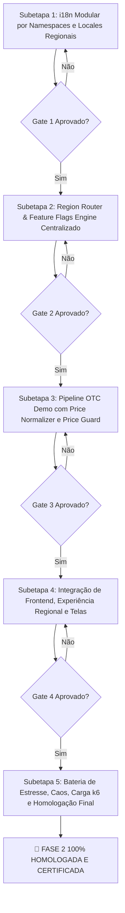

# PLANO GERAL: FASE 2 — EXPANSÃO MULTI-REGIÃO E OTC DEMO COM FEED REAL

**Orquestrador Chefe:** `tech-lead-orchestrator`  
**Data:** 10/10/2026  
**Status do Projeto:** Execução e Implementação Cirúrgica da Fase 2  

---

## 1. Critérios de Pronto da Fase 2 (Invioláveis)

A Fase 2 está formalmente pronta e homologada quando:
1. **6 Países acessam a plataforma**: Brasil (`BR`), México (`MX`), Colômbia (`CO`), Argentina (`AR`), Chile (`CL`), Peru (`PE`).
2. **2 Idiomas funcionam corretamente**: Português (`pt-BR`) e Espanhol regional (`es-MX`, `es-CO`, `es-AR`, `es-CL`, `es-PE`).
3. **6 Moedas exibem corretamente**: `BRL` (R$), `MXN` (Mex$), `COP` (Col$), `ARS` ($), `CLP` (CLP$), `PEN` (S/.).
4. **OTC Demo com Feed Real funciona em todos os países**: Ativos demo vinculados a mercado real (`BTCUSD_OTC`, `ETHUSD_OTC`, `EURUSD_OTC`, `XAUUSD_OTC`) com resiliência total.
5. **Geoblocking bloqueia países não suportados**: Retorna HTTP 403 `GEO_BLOCKED` e redireciona para tela amigável de indisponibilidade regional.
6. **Feature Flags ligam/desligam país e funcionalidades sem deploy**: Propagação atômica em Redis (< 100ms) com fallback no PostgreSQL.
7. **Testes de carga e caos passam**: Bateria completa de testes automatizados unitários, de integração, de estresse (1.000 VUs) e de injeção de caos aprovados com 100% de sucesso.
8. **Invariantes Financeiras e de Segurança Preservadas**: Saldo exclusivamente em `USD_minor` no Blnk Ledger; moedas regionais são estritamente camada de exibição (`Display Only`); zero circulação de dinheiro real.

---

## 2. Seleção de Agentes e Atribuição de Skills

| Agente | Permissão | Responsabilidades | Skills Mobilizadas |
| :--- | :--- | :--- | :--- |
| **`tech-lead-orchestrator`** | `orchestrator` | Decomposição em subetapas, supervisão de handoff, controle de gates e emissão do parecer final. | Todas |
| **`broker-architect-agent`** | `architecture-design` | Arquitetura do pipeline OTC (`Market Data API` → `Price Normalizer` → `Price Guard` → `Redis Stream`), barramento de Feature Flags e matriz multi-região. | `01`, `02`, `03`, `05`, `08` |
| **`backend-implementation-agent`** | `write-code` | Implementação do Region Router, Feature Flags Engine, conectores de dados (`biquote.io`, etc.), `PriceNormalizer` e `PriceGuard`. | `01`, `03`, `04`, `05`, `08`, `17` |
| **`frontend-realtime-agent`** | `write-code` | Implementação da infraestrutura i18n por namespaces (`common`, `auth`, `wallet`, `contracts`, `admin`), suporte aos 6 países, seletor dinâmico e tela de indisponibilidade. | `01`, `03`, `04`, `12`, `13`, `17` |
| **`chart-trading-engineer`** | `write-code` | Integração dos feeds OTC no Lightweight Charts, precisão decimal adaptativa e garantia de 60 FPS. | `01`, `03`, `06`, `11` |
| **`security-reviewer`** | `read-only` | Auditoria de segurança contra IP spoofing, headers forjados, bypass de geoblocking e proteção de rotas admin. | `01`, `04`, `08`, `09` |
| **`financial-correctness-reviewer`** | `read-only` | Auditoria de invariantes contábeis `I-01` a `I-06`: preservação de `USD_minor` no Blnk, zero float e zero dinheiro real. | `01`, `02`, `05`, `08`, `09` |
| **`qa-resilience-agent`** | `write-tests-only` | Construção de testes unitários, testes de integração, cenários de caos e scripts de carga k6. | `01`, `05`, `06`, `07`, `08` |
| **`post-implementation-verifier`** | `read-only` | Verificação forense independente pós-implementação e certificação formal de cada Quality Gate. | `01`, `02`, `03`, `06`, `08`, `10` |

---

## 3. Divisão do Plano Geral em Subetapas Sequenciais

### Detalhamento das Subetapas:
- **`ETAPA_1_I18N_NAMESPACES_LOCALES_TIMEZONES.md`**: Arquivos JSON por namespace (`common`, `auth`, `wallet`, `contracts`, `admin`) para `pt-BR` e os 5 dialetos espanhóis (`es-MX`, `es-CO`, `es-AR`, `es-CL`, `es-PE`). Formatação monetária com `Intl.NumberFormat`, data/hora com `Intl.DateTimeFormat`, Timezone por país e paridade 100% de chaves.
- **`ETAPA_2_REGION_ROUTER_GEOBLOCK_FEATURE_FLAGS.md`**: Detecção segura por IP e `CF-IPCountry`, validação de país ativo, bloqueio com HTTP 403, e gestão das 10 Feature Flags da especificação com cache Redis e persistência PostgreSQL.
- **`ETAPA_3_OTC_FEED_PIPELINE_NORMALIZER_GUARD.md`**: Conector para provedores (`biquote.io`, `RealMarketAPI`, `AllTick`, `FCS API`), módulo `PriceNormalizer` (símbolo, timestamp, outlier) e `PriceGuard` (rejeição >5s, rejeição salto >10%) com fallback estocástico Ornstein-Uhlenbeck e publicação em Redis Streams.
- **`ETAPA_4_FRONTEND_MULTI_REGION_INTEGRATION.md`**: Integração reativa no frontend web: inicialização geográfica, tela de bloqueio com suporte aos idiomas, seletor de moeda/locale/timezone e overlays sem strings hardcoded.
- **`ETAPA_5_BATERIA_TESTES_CAOS_CARGA_CERTIFICACAO.md`**: Testes automatizados de estresse, injeção de caos (queda de Redis, flap de flags, falhas de feed externo), carga k6 com 1.000 VUs e auditoria forense final.
