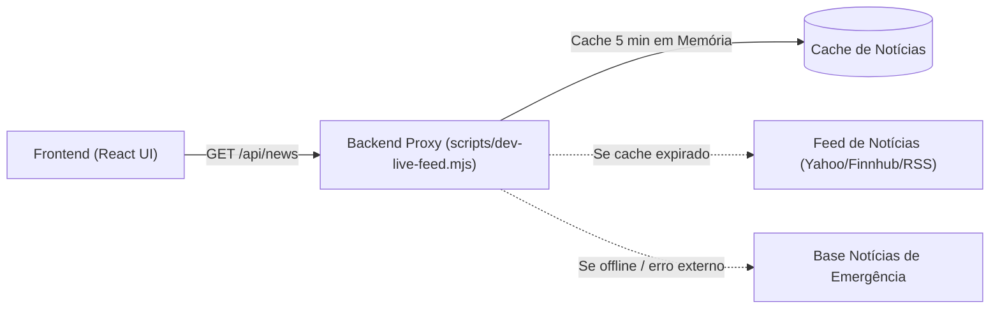

# PLANO 3 — Aba de Notícias de Mercado Financeiro & Cripto
## Detalhamento Completo, Subetapas e Bateria de Testes

---

## 1. Definição Arquitetural e Provedores de Dados

### 1.1. Pesquisa de Provedores de API de Notícias
1. **Yahoo Finance RSS / Google News Finance (Fonte Primária)**:
   - Cobertura global de Economia, Forex, Criptoativos e Mercados Financeiros.
   - 100% gratuito, sem exigência de chaves de API restritivas ou cartões de crédito.
2. **Finnhub.io Market News (Fonte Secundária / Complementar)**:
   - Fornece resumos econômicos e categorias de notícias por classe de ativo.
3. **CryptoPanic / MarketAux**:
   - Fornecem análises de sentimento automatizadas (Bullish, Bearish, Neutro).

### 1.2. Arquitetura de Proxy Resiliente no Backend

- **Por que um Proxy no Backend é Obrigatório**:
  - Evita bloqueios de CORS no navegador;
  - Protege credenciais de APIs externas;
  - Reduz consumo de requisições através de cache de 5 minutos;
  - Permite sanitização estrita de HTML no servidor para bloquear vetores de ataque XSS.

### 1.3. Plano Geral vs. Plano Secundário
- **Plano Geral (Principal)**:
  - Adicionar o botão de Notícias (📰) na `SidebarDock.tsx`.
  - Desenvolver o componente `MarketNewsDrawer.tsx` com:
    - Barra de busca textual;
    - Filtros por categoria: *Todas*, *Câmbio/Forex*, *Cripto*, *Macroeconomia*;
    - Indicador visual de sentimento por notícia: 🟢 **ALTA** (Bullish), 🔴 **BAIXA** (Bearish) ou ⚪ **NEUTRO**;
    - Badges de horário relativo ("há 15 min", "há 1h");
    - Modal de leitura rápida com fonte oficial e botão "Abrir Matéria Original".
- **Plano Secundário (Fallback)**:
  - Barra de rolagem contínua de notícias estilo ticker no rodapé da plataforma com manchetes atualizadas.

---

## 2. Divisão em Subetapas Detalhadas

### Subetapa 3.1: Endpoint Proxy `/api/news` com Cache e Fallback
- **Objetivo**: Implementar no backend (`scripts/dev-live-feed.mjs`) a rota `GET /api/news`:
  - Requisição com timeout de 3 segundos para a fonte de notícias;
  - Cache TTL de 300 segundos (5 minutos);
  - Normalização para o schema:
    `{ id, title, summary, source, url, category, sentiment: 'BULLISH'|'BEARISH'|'NEUTRAL', published_at, image_url }`;
  - Fallback offline robusto com notícias macroeconômicas de relevância global caso a rede externa esteja inativa.

### Subetapa 3.2: Integração com a SidebarDock
- **Objetivo**: Adicionar o ícone de Notícias `📰` à lista de ícones da `SidebarDock.tsx`.
- **Comportamento**: Abertura em aba retrátil de 380px mantendo o gráfico visível e responsivo.

### Subetapa 3.3: Interface Visual da Gaveta de Notícias (`MarketNewsDrawer.tsx`)
- **Objetivo**: Renderização rica dos cards com layout dark moderno, tipografia legível, badges de impacto de mercado e sistema de paginação/atualização com botão "Atualizar Agora 🔄".

### Subetapa 3.4: Sanitização e Segurança Anti-XSS
- **Objetivo**: Filtragem rigorosa de tags HTML perigosas (`<script>`, `<iframe>`, `javascript:`) nos títulos e resumos das notícias para garantir imunidade contra injeção de código.

---

## 3. Matriz de Testes Exaustivos

### 3.1. Testes de Estresse
- Carga de 100 requisições simultâneas em `GET /api/news`. O cache deve responder todas em menos de 10ms sem sobrecarregar a fonte externa.

### 3.2. Testes de Caos
- Queda intencional da conexão com o provedor de notícias externo (simulação de falha DNS/Timeout). O endpoint deve retornar instantaneamente o fallback offline sem retornar erro 500 para a interface.

### 3.3. Testes de Segurança (Anti-XSS)
- Injeção de payload malicioso em título de notícia simulada: ``.
- O frontend e o backend devem escapar o conteúdo, renderizando apenas como texto puro sem execução de scripts.

### 3.4. Critérios de Aceite para Fechamento do Gate 3
- [ ] Rota `GET /api/news` retornando array estruturado de notícias.
- [ ] Cache de 5 minutos ativo e funcionando.
- [ ] Ícone 📰 na Sidebar abrindo a gaveta de notícias com animação suave.
- [ ] Filtros por categoria e busca funcionando em tempo real.
- [ ] Badges de sentimento (Alta, Baixa, Neutro) visíveis em cada card.
