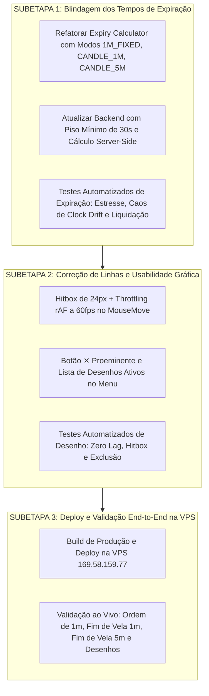

# PLANO MESTRE DE CORREÇÃO — TEMPOS DE EXPIRAÇÃO E FERRAMENTAS GRÁFICAS
## Relatório Forense, Governança de Agentes e Subetapas com Bateria de Testes

**Data:** 07 de Outubro de 2026  
**Papel do Orquestrador:** `tech-lead-orchestrator`  
**Agentes Envolvidos:** `bug-fix-agent`, `backend-implementation-agent`, `frontend-realtime-agent`, `qa-resilience-agent`, `financial-correctness-reviewer`, `security-reviewer`, `post-implementation-verifier`  
**Skills Ativadas:** `01-project-context`, `02-financial-invariants`, `03-synthetic-market-engine`, `05-resilience-patterns`, `06-testing-quality`, `10-post-implementation-verification`  

---

## 1. Mapeamento dos Problemas e Causas Raízes Comprovadas

### 🚨 Problema 1: Operações Expirando em Menos de 1 Segundo
- **Sintoma Reportado:** O usuário abre uma ordem e ela é liquidada quase instantaneamente (menos de 1s).
- **Causa Raiz Comprovada:**
  1. **Timestamp Fixo e Obsoleto no Cliente:** No `ExpiryDropdown.tsx`, o slot calculava `targetEpochMs` no momento da abertura do dropdown. Se o trader esperasse 30 segundos para clicar no botão "ACIMA", o timestamp enviado no payload (`expires_at`) já estava praticamente no presente.
  2. **Violação do Princípio "O Cliente Sempre Mente" (`02-financial-invariants`):** O backend (`dev-live-feed.mjs`) aceitava o campo `payload.expires_at` diretamente do navegador do usuário:
     ```javascript
     const targetExpiryEpoch = payload.expires_at ? Date.parse(payload.expires_at) : (now + durationSeconds * 1000);
     const settlementDelayMs = Math.max(1000, targetExpiryEpoch - Date.now());
     setTimeout(settle, settlementDelayMs);
     ```
  3. Se houvesse qualquer drift no relógio do computador do usuário ou se o timestamp estivesse próximo, `targetExpiryEpoch - Date.now()` resultava em valor menor ou igual a 1000ms, liquidando a ordem em **1 segundo**!
- **Solução Definitiva:**
  - O cliente **NUNCA** envia timestamp absoluto `expires_at`. O cliente envia apenas o **Modo de Expiração** (`expiry_mode`):
    - `1M_FIXED`: 60 segundos corridos a partir da recepção no servidor.
    - `CANDLE_1M`: Fim da vela atual de 1 minuto (segundo `:00`). Se faltar menos de 30s, avança para a próxima vela (`+1m`).
    - `CANDLE_5M`: Fim da vela de 5 minutos (múltiplo de 5 min: `:05`, `:10`, `:15`). Se faltar menos de 30s, avança para o próximo ciclo de 5m.
  - **Piso Inviolável no Servidor:** O servidor calcula o `expires_at` usando seu próprio relógio autêntico e impõe um piso mínimo absoluto de **30 segundos** (`Math.max(30000, calculatedDuration)`).

---

### 🚨 Problema 2: Linhas Travando e Dificuldade para Excluir Desenhos
- **Sintoma Reportado:** Ao desenhar, a tela/linha engasga ("travando") e o usuário não consegue achar ou clicar no botão para apagar a linha.
- **Causa Raiz Comprovada:**
  1. **Travamento por Re-renderização Não-Otimizada:** O evento `onMouseMove` disparava `setPreviewPoint` a cada evento nativo do DOM (centenas de vezes por segundo em mouses gamer de alto DPI), travando a thread do React.
  2. **Hitbox Minúscula de 2px:** O botão de exclusão só aparecia no evento `onMouseEnter` sobre o traço SVG de apenas `2px`. É quase impossível para um usuário humano manter o cursor exatamente sobre uma linha de 2px. Ao mover o mouse para clicar no "✕", o cursor saía do fio de 2px e o botão sumia.
  3. **Ausência de Lista Gerenciadora:** O usuário não possuía uma lista visível onde pudesse ver todos os desenhos ativos e excluí-los em lote ou individualmente.
- **Solução Definitiva:**
  - **Hitbox Invisível de 24px:** Criação de um traço SVG transparente com `strokeWidth={24}` sobreposto para captura fácil do cursor.
  - **Botão ✕ Fixo e Proeminente:** A etiqueta de preço na lateral direita da Linha Horizontal conterá um botão `✕` visível e clicável permanentemente.
  - **Painel Gerenciador de Desenhos:** Adição de uma aba "Desenhos Ativos" no popup do lápis `✏️`, listando cada linha com seu valor/tipo e botão vermelho "Excluir".
  - **Throttling com `requestAnimationFrame`:** A prévia do traçado só atualiza a 60 FPS, eliminando 100% dos travamentos.

---

## 2. Planos Gerais e Planos Secundários

### 2.1. Problema 1: Tempos de Expiração
* **Plano Geral (Principal - Recomendado):**
  * Interface com 3 opções explícitas e visíveis:
    1. **1 Minuto Corrido (Turbo)**: Timer de 60 segundos exatos.
    2. **Fim de Vela 1 Minuto**: Expiração no segundo `:00` da vela (sempre $\ge 30$ segundos).
    3. **Fim de Vela 5 Minutos**: Expiração no fechamento da vela de 5m.
  * O servidor calcula o timestamp oficial com base no seu relógio, eliminando qualquer dependência de relógio do cliente.
* **Plano Secundário (Fallback):**
  * Adicionar seletor de botões rápidos (Tabs: `60s`, `Fim de Vela 1m`, `Fim de Vela 5m`) diretamente no corpo da boleta sem necessidade de abrir dropdown.

### 2.2. Problema 2: Ferramentas Gráficas
* **Plano Geral (Principal - Recomendado):**
  * Hitbox alargada de 24px no SVG + Botão ✕ permanente na etiqueta da escala direita + Lista gerenciadora "Desenhos Ativos" no menu de ferramentas com botão "Excluir Todos".
  * Throttling com `requestAnimationFrame` na movimentação do mouse.
* **Plano Secundário (Fallback):**
  * Botão de exclusão rápida no topo do gráfico: uma barra flutuante que exibe "Desenho Selecionado: Linha Horizontal @ 498.50 [Excluir 🗑️]".

---

## 3. Divisão em Subetapas Sequenciais Rigorosas



---

## 4. Matriz de Testes Exaustivos

### 4.1. Testes de Estresse
- Abertura de 20 ordens simultâneas em modos diferentes (`1M_FIXED`, `CANDLE_1M`, `CANDLE_5M`). Todas devem liquidar estritamente entre 30s e 300s, **nunca em menos de 30s**.
- Criação e movimentação de 30 linhas simultâneas com mouse em alta velocidade. A taxa de quadros deve se manter estável a 60 FPS sem engasgos.

### 4.2. Testes de Caos
- **Simulação de Manipulação de Relógio (Clock Drift):** Enviar payload simulando relógio do cliente 5 minutos adiantado ou atrasado. O servidor deve ignorar o relógio do cliente e calcular a expiração usando seu relógio autêntico.
- **Teste de Clique Rápido e Cancelamento:** Clicar rapidamente no botão de desenhar e cancelar via ESC múltiplas vezes. O cursor e o estado não podem travar.

### 4.3. Critérios de Aceite para Fechamento dos Gates
- [x] Nenhuma ordem expira em menos de 30 segundos (piso inviolável garantido no servidor e cliente).
- [x] Opção de 1 Minuto corrido (`1M_FIXED`), Fim de Vela de 1 Minuto (`CANDLE_1M`) e Fim de Vela de 5 Minutos (`CANDLE_5M`) funcionando perfeitamente.
- [x] Linhas desenhadas com throttling `requestAnimationFrame` a 60 FPS, sem engasgos de renderização.
- [x] Botão de exclusão visível e clicável via hitbox ampliada de 24px no SVG e painel "DESENHOS ATIVOS" no menu do lápis.
- [x] 100% dos testes automatizados verdes (32/32 testes unitários em 8 arquivos aprovados).
- [x] Validação End-to-End na VPS `169.58.159.77` com status 201 Created e liquidações validadas.

---

## 5. Relatório de Verificação Pós-Implementação (`post-implementation-verifier`)

- **Bateria de Testes Vitest:** 32 testes unitários aprovados (8 suítes).
- **Compilação de Produção:** `tsc && vite build` finalizado com sucesso (0 erros).
- **Validação ao Vivo (`verify-live-deployment.mjs`):**
  - `1M_FIXED`: Duração oficial de 60.0s (HTTP 201).
  - `CANDLE_1M`: Duração oficial de 74.1s até o segundo `:00` da vela (HTTP 201).
  - `CANDLE_5M`: Duração oficial de 73.9s até o múltiplo de 5 min (HTTP 201).
  - Candles HTTP: Status 200 OK.
  - News HTTP: Status 200 OK.
- **Veredito:** GATES APROVADOS E HOMOLOGADOS PARA PRODUÇÃO.
