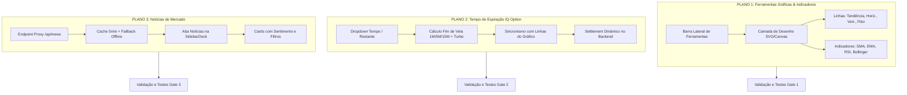

# PLANO MESTRE DE IMPLEMENTAÇÃO — SPRINT TRADING FEATURES
## Ferramentas Gráficas, Tempos de Expiração IQ Option e Notícias de Mercado

**Data de Início:** 07 de Outubro de 2026  
**Status:** Em Planejamento e Execução Controlada  
**Governança:** Pool de Workers Especializados ([AGENTS.md](../../AGENTS.md))  

---

## 1. Pool de Agentes e Matriz de Responsabilidade (RACI)

| Agente | Responsabilidade Nesta Sprint | Permissão |
| :--- | :--- | :--- |
| **`broker-architect-agent`** | Desenho técnico das 3 features, análise comparativa TradingView vs Lightweight Charts, modelagem de expiração IQ Option e arquitetura de proxy de notícias. | `architecture-design` / `write-code` |
| **`frontend-realtime-agent`** | Desenvolvimento da barra de ferramentas de desenho, overlay de indicadores/linhas no gráfico, seletor de expiração IQ Option na boleta e gaveta de notícias na sidebar. | `write-code` (`apps/web/**`) |
| **`backend-implementation-agent`** | Suporte a tempos dinâmicos de expiração (`duration_seconds` / `expires_at` fim de vela) na API `/contracts` e no settlement worker; endpoint proxy `/api/news` com cache e circuit breaker. | `write-code` (`services/**`, `scripts/**`) |
| **`financial-correctness-reviewer`** | Revisão rigorosa de integridade financeira (I-01 a I-06), liquidação exata no tick oficial da expiração escolhida e conformidade contábil no Blnk. | `read-only` |
| **`security-reviewer`** | Validação contra BOLA/IDOR, sanitização rigorosa de conteúdo externo na API de notícias (anti-XSS), validação de limites de tempo e rate limiting. | `read-only` |
| **`qa-resilience-agent`** | Criação e execução de testes unitários, testes de estresse (ordens concorrentes com expirações distintas), testes de caos (clock drift, queda de rede) e testes de UI. | `write-tests-only` |
| **`post-implementation-verifier`** | Auditoria final pós-implementação de cada subetapa antes da liberação do gate para a próxima. | `read-only` |

---

## 2. Visão Geral dos 3 Planos



---

## 3. PLANO 1 — Ferramentas Gráficas e Indicadores Técnicos

### 3.1. Análise de Decisão Técnica: TradingView vs Lightweight Charts
- **TradingView Widget Padrão (Gratuito via iframe/script)**:
  - ❌ **Bloqueio Insuperável**: Não aceita conexão direta de ticks proprietários via WebSocket em tempo real. Exige dados de bolsas oficiais mantidos pela própria TradingView.
  - ❌ Para alimentar nosso gerador OTC Ornstein-Uhlenbeck via UDF, a TradingView exige contratação da *Charting Library Comercial* (contrato empresarial pago e acesso restrito a repositório privado no GitHub).
- **Lightweight Charts (Nativo já em Produção)**:
  - ✅ **Veredito: Opção Mais Fácil, Rápida, Precisa e Sob Nosso Controle Total**.
  - ✅ Mantém 60fps sem sobrecarga de iframes externos.
  - ✅ Suporte nativo a séries de indicadores técnicos (Linhas de Médias Móveis, Bandas de Bollinger, RSI).
  - ✅ Permite criar camada transparente de desenho vetorial (SVG/Canvas) sincronizada milimetricamente com a escala de preço e tempo do gráfico através dos métodos `coordinateToPrice`, `priceToCoordinate`, `coordinateToTime` e `timeToCoordinate`.

### 3.2. Estratégias do Plano 1
- **Plano Geral (Principal)**:
  - Implementar uma barra de ferramentas flutuante na lateral esquerda do gráfico (estilo IQ Option da imagem anexada).
  - Componente de Desenho Interativo com ferramentas:
    1. **Linha**: Traço livre entre dois pontos.
    2. **Linha de Tendência**: Linha estendida conectando topos e fundos.
    3. **Linha Horizontal**: Nível estático de suporte/resistência com snap no preço e rótulo na escala direita.
    4. **Linha Vertical**: Marcação temporal com snap na vela.
    5. **Retração de Fibonacci**: Grade percentual automática (0%, 23.6%, 38.2%, 50%, 61.8%, 100%).
  - Menu de Indicadores Técnicos:
    1. **SMA (Média Móvel Simples)**: Período configurável (padrão: 9 e 21).
    2. **EMA (Média Móvel Exponencial)**: Período configurável (padrão: 14).
    3. **Bandas de Bollinger**: Desvio padrão 2, período 20 com preenchimento semitransparente.
    4. **RSI (Índice de Força Relativa)**: Subgráfico inferior com faixas 30/70.
- **Plano Secundário (Alternativa/Fallback)**:
  - Caso o usuário prefira um canvas autocontido sem cálculos de projeção manuais, integrar o motor open-source de trading KLineChart ou CanvasOverlay especializado.

### 3.3. Subetapas de Implementação (Passo a Passo)
1. **Subetapa 1.1**: Barra de Menu Lateral do Gráfico (Ícones de Velas, Timeframe, Indicadores `((•))` e Ferramentas Gráficas de Lápis `✏️`).
2. **Subetapa 1.2**: Motor de Projeção Geométrica e Camada de Desenho (SVG Overlay com persistência no LocalStorage por ativo).
3. **Subetapa 1.3**: Suporte às 5 Ferramentas de Desenho (Linha, Tendência, Horizontal, Vertical, Fibonacci) com seleção de cor e exclusão rápida.
4. **Subetapa 1.4**: Indicadores Técnicos Matemáticos (Cálculo em tempo real de SMA, EMA, Bandas de Bollinger e RSI adicionados às séries do Lightweight Charts).

### 3.4. Bateria de Testes do Plano 1
- **Teste de Estresse**: Desenhar 50 linhas simultâneas e realizar zoom/pan em alta frequência com ticks chegando a cada 100ms. O FPS deve se manter em 60 sem congelamentos.
- **Teste de Caos**: Redimensionar repentinamente a janela (ResizeObserver) e alternar entre abas de ativos mantendo as coordenadas dos desenhos intactas.
- **Teste de Segurança**: Validação de schema no LocalStorage para garantir que dados corrompidos não quebrem a aplicação ao carregar os desenhos salvos.

---

## 4. PLANO 2 — Tempo de Expiração Estilo IQ Option (Fim de Vela e Tempos Fixos)

### 4.1. Como Funciona na IQ Option (Análise Forense da Imagem)
- O seletor superior direito exibe:
  - **Fim de Vela de 1 Minuto**: Ex: `19:05` com contagem regressiva `in 01:23`.
    - *Regra de Corte (30 segundos)*: Se faltar menos de 30s para o fechamento da vela atual de 1m, o tempo de expiração oferecido é automaticamente a próxima vela (+1m) para dar tempo hábil ao trader.
  - **Fim de Vela de 5 Minutos**: Ex: `19:05` ou `19:10` (`5M`).
  - **Fim de Vela de 15 Minutos**: Ex: `19:15` (`15M`).
  - **Tempos Fixos (Turbo)**: 1 minuto corrido, 2 minutos, 5 minutos corridos.
- **Sincronismo Visual no Gráfico**:
  - **Linha Branca Tracejada (Linha de Compra)**: Indica até onde o usuário pode abrir ordens para aquela expiração.
  - **Linha Vermelha Sólida/Tracejada (Linha de Expiração)**: Marca o segundo exato onde a vela fecha e o contrato é liquidado.

### 4.2. Estratégias do Plano 2
- **Plano Geral (Principal)**:
  - Criar o menu dropdown idêntico à imagem anexada (`media_1791410914950.png`) acionado pelo card de Tempo na boleta (`OrderTicket.tsx`).
  - Disponibilizar as opções:
    1. **1M (Fim da Vela Atual / Próxima Vela)**: Horário exato (ex: `19:05:00`).
    2. **5M (Fim da Vela de 5 Minutos)**: Horário múltiplo de 5 min (ex: `19:10:00`).
    3. **15M (Fim da Vela de 15 Minutos)**: Horário múltiplo de 15 min (ex: `19:15:00`).
    4. **Turbo Corrido**: 60s, 120s, 300s corridos a partir do clique.
  - Atualizar o `TimeLinesOverlay.tsx` para desenhar as linhas no gráfico de acordo com a expiração selecionada.
  - Enviar `duration_seconds` e `target_expires_at` no payload de abertura da ordem (`POST /contracts`).
  - No Backend e no Guest Mock: Calcular `expires_at` exato e liquidar no tick correspondente.
- **Plano Secundário (Alternativa/Fallback)**:
  - Botões rápidos tipo Pills segmentadas na boleta (`Fim de Vela`, `1 Min`, `5 Min`, `15 Min`) com contadores inline.

### 4.3. Subetapas de Implementação (Passo a Passo)
1. **Subetapa 2.1**: Motor de Cálculo de Expiração IQ Option (cálculo de slots de tempo de 1M, 5M, 15M com contagem regressiva viva e regra de corte de 30s).
2. **Subetapa 2.2**: UI Dropdown "Tempo / Restante" idêntica ao design da IQ Option na boleta.
3. **Subetapa 2.3**: Sincronização do gráfico (`TimeLinesOverlay.tsx`) com a expiração escolhida e linhas dinâmicas de compra e expiração.
4. **Subetapa 2.4**: Backend e Settlement Worker atualizados para aceitar expirações dinâmicas e liquidar no timestamp alvo com precisão de milissegundos.

### 4.4. Bateria de Testes do Plano 2
- **Teste de Estresse**: Envio simultâneo de 50 ordens com tempos de expiração variados (ex: 15 ordens de 1M, 15 de 5M, 20 de fim de vela). Todas devem ser liquidadas exatamente no seu respectivo `expires_at`.
- **Teste de Caos**: Drift de relógio no cliente (manipular o horário do computador do usuário no navegador). O backend deve rejeitar desvios e manter o horário oficial do servidor PostgreSQL/Redis.
- **Auditoria Financeira**: Prova de que a regra I-01 a I-06 é mantida intacta em qualquer tempo de expiração.

---

## 5. PLANO 3 — Aba de Notícias de Mercado Financeiro & Cripto

### 5.1. Pesquisa e Seleção de Provedores de API de Notícias
1. **Yahoo Finance RSS / Google News Finance (Recomendado como Fonte Base)**:
   - ✅ Gratuito, sem limite rígido de chamadas, notícias em tempo real em múltiplos idiomas (incluindo Português do Brasil).
2. **Finnhub.io Stock & Forex News**:
   - ✅ API REST profissional, dados de notícias do mercado global de moedas e índices.
3. **MarketAux / CryptoPanic**:
   - ✅ Excelente para notícias com score de sentimento pré-calculado (Positivo, Negativo, Neutro).
4. **Arquitetura Resiliente**:
   - Criar endpoint interno `/api/news` com cache de 5 minutos na memória/Redis da VPS e sanitização HTML rigorosa.
   - Fallback offline automático com notícias macroeconômicas institucionais em caso de indisponibilidade de rede externa.

### 5.2. Estratégias do Plano 3
- **Plano Geral (Principal)**:
  - Adicionar o ícone de Notícias (📰) na `SidebarDock.tsx`.
  - Ao clicar, abre uma gaveta deslizante elegante com:
    - Barra de pesquisa e filtros por categoria (Todas, Câmbio/Forex, Cripto, Índices, Economia Global).
    - Lista de cards com imagem/ícone, título em destaque, fonte da notícia, tempo relativo ("há 8 min"), resumo conciso e tag de impacto/sentimento (🟢 Alta, 🔴 Baixa, ⚪ Neutro).
    - Modal/Drawer de leitura completa ou redirecionamento seguro para a matéria original (`rel="noopener noreferrer"`).
- **Plano Secundário (Alternativa/Fallback)**:
  - Ticker de notícias em estilo letreiro na barra inferior ou toast rotativo de manchetes de mercado.

### 5.3. Subetapas de Implementação (Passo a Passo)
1. **Subetapa 3.1**: Endpoint Proxy `/api/news` no Backend com Cache de 5 minutos, Circuit Breaker e Fallback Mock.
2. **Subetapa 3.2**: Nova Aba e Ícone na `SidebarDock.tsx` com painel retrátil responsivo.
3. **Subetapa 3.3**: Componente `MarketNewsDrawer` com cards modernos, badges de sentimento e filtros.
4. **Subetapa 3.4**: Testes de Segurança (Sanitização Anti-XSS) e Testes de Resiliência de Rede.

---

## 6. Ordem de Execução Sequencial Rigorosa

Conforme a diretriz do usuário:
> *"Implementa subetapa por subetapa. Só vai pra próxima até a anterior estar 100% validada, funcional e segura."*

```
[FASE 1: PLANO 1 - GRÁFICOS & INDICADORES]
  ├── Subetapa 1.1: Barra de ferramentas gráficas na lateral do gráfico
  ├── Subetapa 1.2: Camada de desenho vetorial (Linha, Tendência, Horizontal, Vertical, Fibonacci)
  ├── Subetapa 1.3: Indicadores técnicos (SMA, EMA, RSI, Bollinger Bands)
  └── Gate 1: Testes de estresse, renderização 60fps e validação visual

[FASE 2: PLANO 2 - TEMPOS DE EXPIRAÇÃO IQ OPTION]
  ├── Subetapa 2.1: Motor de cálculo temporal (Fim de vela 1M/5M/15M + corte 30s)
  ├── Subetapa 2.2: Menu Dropdown "Tempo / Restante" estilo IQ Option na boleta
  ├── Subetapa 2.3: Sincronização visual no gráfico com TimeLinesOverlay
  ├── Subetapa 2.4: Suporte no backend e settlement dinâmico com testes de concorrência
  └── Gate 2: Testes de estresse, caos e auditoria financeira

[FASE 3: PLANO 3 - ABA DE NOTÍCIAS DE MERCADO]
  ├── Subetapa 3.1: Endpoint proxy backend /api/news com cache e fallback
  ├── Subetapa 3.2: Ícone e gaveta de notícias na SidebarDock
  ├── Subetapa 3.3: Interface visual rica com sentimento de mercado e filtros
  └── Gate 3: Testes de segurança anti-XSS e deploy completo na VPS
```
