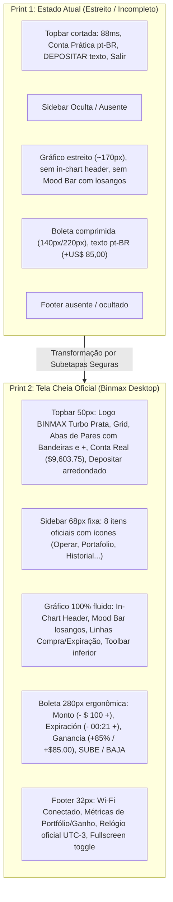

# Plano Mestre de Implementação: Traderoom Desktop Tela Cheia Binmax Option
## Alinhamento com a Imagem Alvo de Alta Fidelidade (IQ Option / Binmax Desktop)

**Orquestrador**: `tech-lead-orchestrator`  
**Data**: 2026-10-09  
**Referência Alvo**: `docs/referencias/alvo-binmax-principal.png` (Print 2 — Tela Cheia Widescreen 1920x1080)  
**Situação Diagnosticada**: `docs/referencias/atual-ticket.png` / Print 1 (Visual atual estreito/cortado)  

---

## 1. Pool de Agentes Especializados e Matriz de Skills

| Subagent | Papel no Plano | Permissão | Skills Chave |
| :--- | :--- | :--- | :--- |
| **`tech-lead-orchestrator`** | Orquestração, governança e fechamento de gates | Coordenação | `01`, `15`, `20` |
| **`broker-architect-agent`** | Arquitetura de layout, isolamento e invariantes | Design / Code | `01`, `02`, `03`, `05`, `08` |
| **`surgical-frontend-agent`** | Refatoração cirúrgica em `apps/web/**` com menor diff | `write-code` | `12`, `13`, `15`, `17` |
| **`chart-trading-engineer`** | Engenharia do canvas, rAF 60 FPS, Mood Bar e Overlays | `write-code` | `03`, `11` |
| **`iq-fidelity-reviewer`** | Análise de sobreposição e fidelidade visual contra o Print 2 | `read-only` | `12`, `14`, `15` |
| **`compliance-risk-reviewer`** | Verificação de invariantes, simetria SUBE/BAJA e integridade | `read-only` | `01`, `02`, `18` |
| **`qa-resilience-agent`** | Criação e execução de baterias de estresse, caos e segurança | `write-tests` | `05`, `06`, `10` |
| **`regression-guardian-agent`**| Blindagem contra quebras e auditoria da suíte de regressão | `read-only` | `06`, `19` |

---

## 2. Diagnóstico Comparativo: Print 1 (Atual) vs Print 2 (Alvo Tela Cheia)

---

## 3. Divisão Detalhada em 7 Subetapas de Implementação

### SUBETAPA 01: Refatoração da Malha Estrutural do Shell (100vw x 100vh Full-Bleed)
- **Objetivo**: Eliminar o layout comprimido e garantir preenchimento widescreen fluido no `TerminalLayout.tsx` e `styles.css`.
  - Header fixo com altura de 50px e `min-width: 0`.
  - Sidebar fixa à esquerda de exatamente 68px.
  - Boleta (Order Dock) fixa à direita de exatamente 280px.
  - Footer fixo na base de 32px.
  - Centro (Canvas do gráfico) flexível ocupando 100% do espaço restante sem rolagem externa.
- **Arquivos**:
  - `apps/web/src/components/layout/TerminalLayout.tsx`
  - `apps/web/src/styles.css`
- **Baterias de Teste Obrigatórias**:
  - *Unitários*: Dimensões exatas dos containers em modo desktop.
  - *Estresse*: Resize dinâmico contínuo entre 800px e 2560px sem colapso de nós.
  - *Caos*: Viewport 0x0px ou colapso temporário rejeitado sem lançar exceções.
  - *Segurança*: Não permitir que estilos externos vazem para o terminal.

---

### SUBETAPA 02: Terminal Header de Alta Fidelidade
- **Objetivo**:
  - Exibir o logo oficial `BINMAX` Turbo Prata com chevron duplo à esquerda.
  - Botão de seletor de grid multi-chart (4 quadrados).
  - Abas horizontais com bandeiras circulares de países (`NZD/JPY`, `EUR/USD`, `EUR/CAD`, `GBP/JPY`, `USD/JPY`), subtítulo `Turbo` e botão de fechar `×`.
  - Aba ativa com realce ciano `#00e5ff` na borda inferior.
  - Botão `+` para abrir modal/catálogo institucional de 36 ativos.
  - Seletor de conta com Avatar circular, `Cuenta real ▾` e saldo verde tabular formatado em dólar internacional (`$9,603.75`).
  - Botão verde arredondado `Depositar` com ícone SVG de carteira.
- **Arquivos**:
  - `apps/web/src/components/header/TerminalHeader.tsx`
  - `apps/web/src/components/header/AccountSelectorDropdown.tsx`
  - `apps/web/src/lib/money.ts`
- **Baterias de Teste Obrigatórias**:
  - *Unitários*: Renderização das abas, ativação, fechamento e cálculo de payout.
  - *Estresse*: Inclusão rápida de múltiplas abas com overflow horizontal suave.
  - *Caos*: Ativo corrompido no estado caindo em fallback seguro.
  - *Segurança*: Saldo e email protegidos contra manipulação via DOM.

---

### SUBETAPA 03: Sidebar Vertical Esquerda Institucional (8 Itens)
- **Objetivo**:
  - Manter a Sidebar de 68px fixa com os 8 itens oficiais:
    1. `Operar` (destaque ativo com borda lateral ciano `#00e5ff`)
    2. `Portafolio`
    3. `Historial`
    4. `Torneos`
    5. `Análisis`
    6. `Tutoriales`
    7. `Promociones`
    8. `Ajustes`
  - Garantir abertura suave dos drawers correspondentes sem perturbar o gráfico central.
- **Arquivos**:
  - `apps/web/src/components/sidebar/SidebarDock.tsx`
- **Baterias de Teste Obrigatórias**:
  - *Unitários*: Existência e clique dos 8 botões da sidebar.
  - *Estresse*: Cliques alternados rápidos entre as abas.
  - *Caos*: Fechamento via `Escape` e eventos de redimensionamento.
  - *Segurança*: Drawers isolados sem acesso indevido a dados de sessão alheia.

---

### SUBETAPA 04: Gráfico Central & Camadas de Overlays em Tempo Real
- **Objetivo**:
  - Alinhar todos os overlays visuais com o Print 2:
    1. **In-chart Header**: Topo esquerdo do gráfico com bandeiras do ativo, nome `NZD/JPY ▾ Turbo` e botões circulares `(i)`, `🔔`, `★`.
    2. **Traders Mood Bar**: Coluna vertical de losangos na borda esquerda: `SUBE 52%` (verde) e `BAJA 48%` (vermelho).
    3. **Linhas de Tempo Oficiais**:
       - Linha vertical tracejada branca com cabeçalho `HORA DE COMPRA 00:08` e ícone de relógio na base.
       - Linha vertical contínua vermelha de expiração `00:21` com ícone de bandeira vermelha.
    4. **Linha de Preço Atual**: Linha verde pontilhada horizontal com badge preenchido `89.587` no eixo Y.
    5. **Toolbar Inferior Esquerda**: Tipo de velas, timeframe, ferramentas de desenho e tela cheia.
- **Arquivos**:
  - `apps/web/src/chart/PriceChart.tsx`
  - `apps/web/src/chart/TradersMoodBar.tsx`
  - `apps/web/src/chart/TimeLinesOverlay.tsx`
  - `apps/web/src/chart/ChartDrawingToolbar.tsx`
- **Baterias de Teste Obrigatórias**:
  - *Unitários*: Posicionamento matemático e projeção de coordenadas no Canvas.
  - *Estresse*: 1.000 ticks/segundo via `RafChartUpdater` mantendo 60 FPS.
  - *Caos*: Dimensões do canvas colapsadas para 0x0px rejeitadas pelo guardrail sem crash.
  - *Segurança*: Sanitização estrita de coordenadas e timestamps.

---

### SUBETAPA 05: Boleta de Negociação (Order Ticket) Ergonômica
- **Objetivo**:
  - Ajustar `OrderTicket.tsx` para preencher perfeitamente os 280px de largura com alinhamento vertical harmônico:
    - Campo `Monto` com tooltip `?`, `- $ 100 +`.
    - Campo `Expiración` com tooltip `?`, `- 00:21 +` e ícone de relógio.
    - Seção `Ganancia` com tooltip `?`, `+85%` grande verde neon e `+$85.00` formatado em dólar.
    - Botão verde grande `SUBE` (ícone gráfico em alta + texto SUBE).
    - Botão vermelho grande `BAJA` (ícone gráfico em baixa + texto BAJA).
    - Prevenção contra duplo clique e idempotência na emissão de ordens.
- **Arquivos**:
  - `apps/web/src/trade/OrderTicket.tsx`
- **Baterias de Teste Obrigatórias**:
  - *Unitários*: Formatação de valores, cálculo de lucro e payout.
  - *Estresse*: Clique repetido de alta frequência bloqueado pelo lock atômico.
  - *Caos*: Queda de rede na emissão exibindo toast de erro amigável sem desconfigurar o ticket.
  - *Segurança*: Payout e saldo sempre verificados pelo backend; valor nunca alterado pelo cliente.

---

### SUBETAPA 06: Terminal Footer Status Bar de Alta Precisão
- **Objetivo**:
  - Reformular `TerminalFooter.tsx` com as 3 seções do Print 2:
    - Esquerda: Indicador de rede: bolinha verde `●` + ícone de sinal Wi-Fi + `Conectado`.
    - Centro: Estatísticas em tempo real da sessão: `Portafolio total $0.00`, `Ganancia de hoy $0.00`, `Operaciones abiertas 0`.
    - Direita: Ícone de relógio `🕐` + `Hora actual: 08 OCT 2024, 02:20:22 (UTC-3)` + botão fullscreen toggle.
- **Arquivos**:
  - `apps/web/src/components/footer/TerminalFooter.tsx`
- **Baterias de Teste Obrigatórias**:
  - *Unitários*: Formatação de horário em espanhol neutro e cálculo de operações abertas.
  - *Estresse*: Atualização de relógio de 1s contínua sem disparar re-render do canvas.
  - *Caos*: Falha na Fullscreen API tratada graciosamente.
  - *Segurança*: Zero injeção de HTML no relógio do rodapé.

---

### SUBETAPA 07: Bateria de Certificação Global, Testes de Caos & Regressão
- **Objetivo**:
  - Execução da suíte completa de testes de regressão (mais de 270 testes automatizados).
  - Validação de tipagem TypeScript (`tsc --noEmit`).
  - Verificação visual comparativa com `alvo-binmax-principal.png`.
  - Homologação formal com relatório final assinado pelos agentes participantes.
