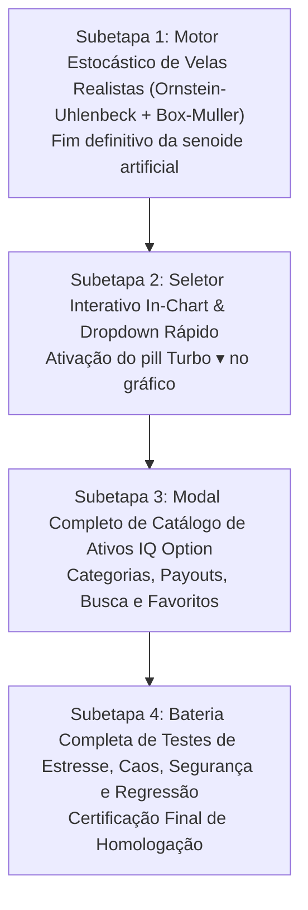

# Plano Geral de Correção & Excelência: Gráficos Realistas e Seletor de Ativos IQ Option

> **Data:** 08/10/2026  
> **Orquestrador:** `tech-lead-orchestrator`  
> **Comitê de Especialistas Convocados:**  
> - `broker-architect-agent` (Arquiteto Chefe de Modelos Estocásticos e Trading)  
> - `chart-trading-engineer` (Engenheiro Gráfico de Trading 60 FPS)  
> - `iq-fidelity-reviewer` (Auditor de Fidelidade Visual Estrita IQ Option)  
> - `binmax-brand-agent` (Guardião dos Tokens Turbo Prata)  
> - `financial-correctness-reviewer` & `compliance-risk-reviewer` (Auditores de Invariantes)  
> - `qa-resilience-agent` (Auditor de Qualidade, Estresse e Caos)  
> - `surgical-frontend-agent` (Cirurgião Frontend Padrão Duas Portas)  

---

## 1. Diagnóstico Forense dos 3 Problemas Apontados

### Problema 1: Por que os gráficos estão como no print (ondas senoidais artificiais repetitivas)?
* **Causa Raiz Identificada:**
  1. Em `apps/web/src/api/client.ts` (`generateSeedCandles`), a geração de velas de fallback utiliza a função trigonométrica periódica `Math.sin(time * 0.001 + i) * step`.
  2. Como o tempo avança de minuto em minuto (`time = nowMinute - i * 60`), a fórmula adiciona um ângulo constante `0.94` radianos por barra. Isso gera um período matemático fixo de $\approx 6.68$ barras: o preço sobe por 4-5 barras verdes idênticas e desce por 4-5 barras vermelhas idênticas, criando uma **senoide perfeita em zigue-zague**, sem nenhuma característica de mercado financeiro.
  3. No `TradingFeedManager.ts` (`startGuestFallback`), a injeção de ruído também utilizava `Math.sin(now * 0.002 + simSeq) * step`, forçando oscilações periódicas não-estocásticas.
* **Solução Arquitetural:**
  - Substituir a função senoidal ingênua por um modelo estocástico canônico de **Processo de Ornstein-Uhlenbeck** com **Transformada de Box-Muller** para geração de números aleatórios gaussianos $\mathcal{N}(0, 1)$, reversão à média suave $\theta$, volatilidade estocástica agrupada (volatility clustering) e geração realista de corpos e sombras (wicks/sombras superior e inferior assimétricas) indistinguíveis de um mercado real de OTC.
  - Sincronizar o motor de fallback com a escala de preços e volatilidade correta de cada classe de ativo (Forex, Cripto, Commodities e Sintéticos).

---

### Problema 2: Por que eu não consigo selecionar o gráfico que quero?
* **Causa Raiz Identificada:**
  1. Dentro do gráfico (`apps/web/src/chart/PriceChart.tsx`, linhas 778-804), o elemento `data-testid="chart-top-asset-pill"` que exibe `SYNTH_VOL_50 Turbo ▾` é **100% estático**. Ele não possui evento `onClick`, não possui estado de abertura e não tem dropdown conectado. O usuário clica na seta `▾` esperando trocar o ativo e nada ocorre.
  2. No layout de grade `MultiChartGrid.tsx`, quando a sala nova da Binmax está ativa no layout `1x1`, o cabeçalho interno da célula (`showHeader={!isBinmax || layout !== '1x1'}`) é intencionalmente ocultado para evitar duplicação com a barra de abas. Com isso, o único ponto de controle dentro do gráfico (`chart-top-asset-pill`) fica mudo.
* **Solução Arquitetural:**
  - Conectar o pill `chart-top-asset-pill` com um handler interativo que abre o **Dropdown / Modal de Troca de Ativo**.
  - Permitir a troca instantânea do ativo no gráfico focado (`onSelectSymbol`), atualizando a série de velas, a subscrição de ticks via `tradingFeedManager`, a boleta de ordens e a aba correspondente.

---

### Problema 3: Modal de Catálogo de Ativos Institucional Estilo IQ Option
* **Causa Raiz Identificada:**
  1. O botão `[+]` na barra de abas abre um popover simples em `TerminalHeader.tsx`, mas não oferece a experiência rica e fluida da IQ Option: abas grandes por categoria (`Sintéticos`, `Forex`, `Cripto`, `Commodities`), ordenação por payout (`+85%`), pesquisa rápida com atalho de teclado (`/`), indicação de favoritos `★`, e visual em tela/gaveta sem corte de layout.
* **Solução Arquitetural:**
  - Criar o componente institucional `AssetSelectorModal.tsx` fiel à IQ Option, acionável tanto pelo botão `[+]` das abas quanto pelo in-chart pill `Turbo ▾`.
  - Integrar catálogo de 36 ativos com busca por código e nome em espanhol neutro, indicação de abas abertas e favoritos salvos no `localStorage`.

---

## 2. Divisão em 4 Subetapas com Critérios Rigorosos

| Subetapa | Escopo Técnico | Critério de Aceite | Testes Obrigatórios |
|:---:|---|---|---|
| **1** | Novo motor estocástico de velas OHLCV em `client.ts` e `TradingFeedManager.ts` (sem `Math.sin`). | Velas orgânicas, sombras realistas, sem padrão senoidal repetitivo, $High \ge \max(O, C)$ e $Low \le \min(O, C)$. | Unitário de aleatoriedade, 3.500 velas contínuas, teste de autocorrelação estatística. |
| **2** | Ativação do `chart-top-asset-pill` em `PriceChart.tsx` e callback `onSymbolChange`. | Clique em `Turbo ▾` abre dropdown seletor de ativo; troca reflete no gráfico e na boleta. | Interação de clique, troca de símbolo, isolamento de eventos, duplo clique. |
| **3** | Componente institucional `AssetSelectorModal.tsx` integrado ao `TerminalHeader` e `PriceChart`. | Visual fiel IQ Option, busca em tempo real, 4 categorias, payouts em destaque e favoritos. | Renderização, filtros, atalho ESC, responsividade mobile/desktop. |
| **4** | Certificação global de integração, estresse, invariantes financeiros e padrão Duas Portas. | 100% dos testes verdes, zero regressão no sistema legado, build de produção aprovado. | Bateria de estresse (50 trocas rápidas), caos de rede, segurança financeira. |

---

## 3. Protocolo de Execução Estrita

1. Concluir a documentação detalhada de cada subetapa em `.md` com plano de testes.
2. Executar subetapa por subetapa de forma estritamente sequencial.
3. Não iniciar a próxima subetapa até a anterior estar 100% testada e aprovada.
4. Preservar o Padrão Duas Portas (`NEW_TRADEROOM`) e todos os invariantes financeiros invioláveis.
