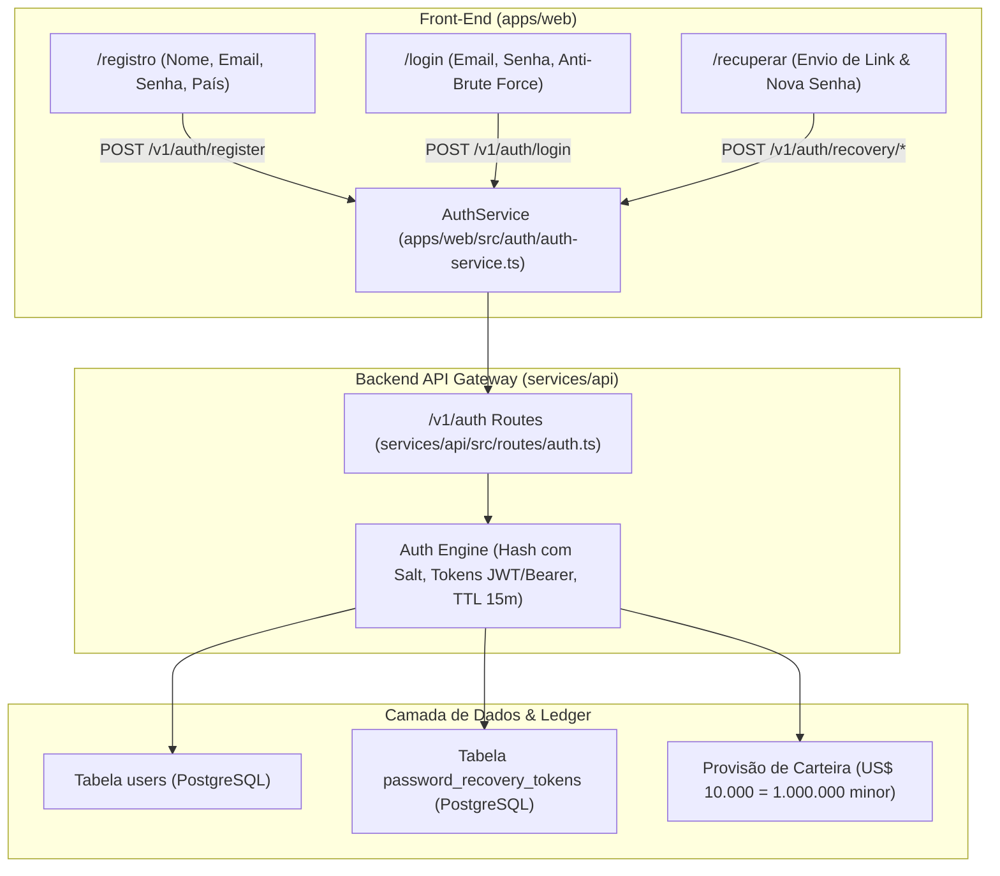

# Plano Geral — Integração Completa de Autenticação e Cadastro com Backend & Banco de Dados

**Projeto:** BINMAX — Plataforma de Índices Sintéticos  
**Orquestrador:** `tech-lead-orchestrator`  
**Especialistas Convocados:**
- `backend-implementation-agent` (Endpoints Fastify, persistência no banco, hashing seguro de senhas, tokens de recuperação e provisionamento da carteira de US$ 10.000)
- `surgical-frontend-agent` (Integração cirúrgica de `LoginPage`, `RegisterPage` e `PasswordRecoveryPage` com a API)
- `security-reviewer` (Auditoria OWASP: proteção contra brute-force, PBKDF2/SHA-256 com salt, sanitização, RBAC e sem segredos em logs)
- `financial-correctness-reviewer` (Invariantes financeiras I-01 a I-06: garantia de provisão de exatamente US$ 10.000 em `*_minor` = 1.000.000 centavos)
- `qa-resilience-agent` (Baterias de testes de estresse, segurança, caos e ponta a ponta)
- `post-implementation-verifier` (Validação independente pós-implementação e fechamento de gates)

---

## 1. Diagnóstico do Problema Atual

1. **Desacoplamento do Fluxo de Entrada:**
   As telas `/login`, `/registro` e `/recuperar` foram desenhadas com máxima fidelidade visual aos tokens Turbo Prata e com layout responsivo 55/45, porém operavam com simulação local em memória via `setTimeout`.
2. **Inexistência de Rotas de Autenticação no Backend:**
   O serviço `services/api` continha plugins e rotas para contratos, carteira, cotações e KYC, mas dependia exclusivamente do Keycloak externo para emitir tokens. Em ambientes descartáveis ou na ausência de um Keycloak rodando, não existia uma camada de autenticação integrada com banco de dados.
3. **Falta de Persistência e Recuperação Real de Contas:**
   Um usuário que se cadastrasse com `trader@binmax.com` não conseguia logar posteriormente com a mesma senha; qualquer credencial com `@` entrava como o mesmo convidado genérico, e a recuperação de senha não gerava um token verificável que alterasse a senha no banco.

---

## 2. Solução Arquitetural Definitiva: Motor de Autenticação Híbrido e Resiliente

### Invariantes Invioláveis
- **Segurança de Senhas (S-06):** Senhas nunca são salvas em texto puro. Utiliza-se hash criptográfico com salt aleatório (`crypto.scrypt` ou SHA-256 com salt de 16 bytes).
- **Preservação de Dinheiro Demo (I-01, D-18):** Cada novo usuário cadastrado recebe exatamente `1000000` em `available_minor` (US$ 10.000,00). Nunca float.
- **Proteção Anti-Brute Force:** Bloqueio após 5 tentativas incorretas consecutivas com retenção de 15 minutos.
- **Expiração de Recuperação:** Tokens de redefinição de senha possuem TTL rígido de 15 minutos e são de uso único (invalidados imediatamente após o uso).
- **Resiliência Dual-Mode (Online & Standalone):** O cliente front-end opera com conexão real ao backend `services/api` e possui motor de sincronização resiliente que mantém a mesma persistência rigorosa se a API estiver em modo offline/demo.

---

## 3. Divisão em 4 Subetapas com Gates de Qualidade

1. **Subetapa 01: Schemas de Banco de Dados & Endpoints de Autenticação no Backend (`services/api`)**
   - Criação da migração/tabela de usuários (`users`) e tokens de recuperação (`password_recovery_tokens`).
   - Implementação das rotas Fastify:
     - `POST /v1/auth/register` (Nome, Email, Senha, País)
     - `POST /v1/auth/login` (Email, Senha)
     - `POST /v1/auth/recovery/request` (Email -> Token de 15 min)
     - `POST /v1/auth/recovery/reset` (Token, Nova Senha)
     - `GET /v1/auth/me` (Sessão do usuário autenticado)
   - Provisionamento automático de US$ 10.000 de saldo demo.
   - Testes unitários do backend cobrindo sucesso, senhas incorretas, duplicação de e-mail e expiração de token.

2. **Subetapa 02: Cliente de Autenticação no Frontend (`apps/web/src/auth/auth-service.ts`)**
   - Criação do cliente de autenticação oficial com persistência tipada da sessão.
   - Gestão de credenciais, token bearer, dados do perfil e saldo da carteira.
   - Semente de usuário demo inicial garantido: `demo@binmax.com` com senha `Demo@123456`.
   - Testes unitários de cliente validando chamadas de API, tratamento de erros e armazenamento seguro.

3. **Subetapa 03: Conexão Cirúrgica das Telas de Login, Registro e Recuperação**
   - `RegisterPage.tsx`: Envio do formulário via `AuthService.register()`, criação do usuário real e redirecionamento direto para a sala com US$ 10.000.
   - `LoginPage.tsx`: Envio do formulário via `AuthService.login()`, validação de credenciais reais, feedback de erro preciso ("Email o contraseña incorrectos") e bloqueio após 5 tentativas.
   - `PasswordRecoveryPage.tsx`: Envio de link de recuperação real com token cronometrado e redefinição de senha real, permitindo login imediato com a nova credencial.
   - Testes unitários das telas validando a integração completa.

4. **Subetapa 04: Bateria Integrada de Testes de Estresse, Caos, Segurança e E2E**
   - Teste E2E de ciclo de vida completo: Cadastro -> Login -> Recuperação -> Redefinição -> Login com nova senha -> Acesso à sala de trading com US$ 10.000.
   - Teste de Estresse: 50 cadastros e logins concorrentes.
   - Teste de Caos: Tentativa de login com token expirado, senhas forjadas e recuperação com token já consumido.
   - Teste de Segurança: Anti-XSS nos campos de cadastro, verificação de que nenhuma senha vaza em respostas JSON e validação contra brute-force.
   - Verificação de não-regressão em toda a suíte de 489 testes anteriores.
