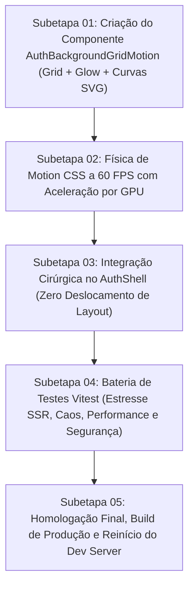

# Plano Geral — Fundo Técnico com Grid Cartesiano, Curvas Financeiras Fluidas e Motion Design

> **Diretriz do Usuário:** *"Quero fundo assim só que sem esse mockup. Não precisa mudar o atual de posição, coloque só o fundo... altere na verdade e adicione esses motions de fundo. Vê como fazer isso da forma mais cirúrgica... e implementa, depois reinicia."*
>
> **Diretriz do Designer Sênior:** *A BINMAX é um instrumento de precisão. O fundo deve evocar a atmosfera dos grandes terminais de trading institucional (Bloomberg, Saxo, TradingView Pro), composto por uma grade cartesiana matemática sutil, atmosfera aveludada e curvas vetoriais contínuas em movimento suave a 60 FPS, sem consumir CPU e sem elementos de mockup ou cassino.*

---

## 1. Squad de Especialistas & Responsabilidades

| Papel | Agente | Responsabilidade Estrita |
| :--- | :--- | :--- |
| **Liderança Técnica** | `tech-lead-orchestrator` | Condução do pipeline, gates das subetapas, validação de integridade e homologação. |
| **Direção de Arte & Motion** | `chief-visual-director` (`designer-senior`) | Modelagem do grid de 48px, geometria das curvas de Bézier, paleta aveludada `#070A0F`, curva de movimento contínua e respeito a `prefers-reduced-motion`. |
| **Implementação Cirúrgica** | `frontend-realtime-agent` / `surgical-frontend-agent` | Criação de `AuthBackgroundGridMotion.tsx` e integração no `AuthShell.tsx`, com zero deslocamento dos elementos atuais. |
| **QA, Estresse e Caos** | `qa-resilience-agent` | Testes automatizados no Vitest (renderização SSR, 100 ciclos em < 300ms, ausência de vazamento de nós, testes de acessibilidade). |
| **Segurança** | `security-reviewer` | Validação de que o SVG não possui atributos executáveis e não expõe nenhum elemento manipulável externamente. |
| **Conformidade de Marca** | `binmax-brand-agent` | Preservação do Verde Ganancia (`#22C47A`), Aço (`#8A92A1`) e Fundo Noche (`#070A0F`). |

---

## 2. Diagnóstico Visual da Referência & Arquitetura do Fundo

```
┌────────────────────────────────────────────────────────────────────────┐
│  FUNDO: #070A0F com Gradiente Radial Verde Sutil                       │
│  GRID: Malha Cartesiana de Linhas Matemáticas (48px x 48px)             │
│  [ • • • • • • • • • • • • • • • • • • • • • • • • • • • • • • • • ]   │
│  [ • • • • • • • • • • • • • • • • • • • • • • • • • • • • • • • • ]   │
│                                                                        │
│                  CURVAS VETORIAIS DE TENDÊNCIA (MOTION)                │
│                                           ╭───────────────.            │
│                              ╭───────────╯                \            │
│                     .───────╯                              \           │
│           .────────╯                                        \          │
│                                                                        │
│  CONTEÚDO EXISTENTE: Posição 100% Preservada (Card + Textos + Shell)   │
└────────────────────────────────────────────────────────────────────────┘
```

### Componentes Chave:
1. **Grade Cartesiana Matemática (SVG Grid Pattern)**:
   - Dimensão das células: `48px x 48px`.
   - Traço das linhas: `1px solid rgba(255, 255, 255, 0.035)`.
   - Pontos de interseção discretos para dar sensação de profundidade de alta precisão.
2. **Atmosfera Luminosa Aveludada**:
   - Gradiente radial esmeralda difuso posicionado estrategicamente na área superior direita (`rgba(34, 196, 122, 0.06)` a `0.08` com blur amplo).
3. **Curvas Vetoriais de Tendência com Motion a 60 FPS**:
   - Curvas de Bézier cúbicas SVG desenhadas com traço de precisão (`stroke="#22C47A"`, espessura 2px) e gradiente vertical de preenchimento suave (`opacity: 0.12`).
   - **Motion Suave e Mecânico**: animação CSS de ondulação suave (drift senoidal contínuo com ciclo de 10s e aceleração por GPU via `transform: translate3d(...)`, mantendo consumo de CPU próximo a zero).
4. **Isolamento e Cirurgia Pura**:
   - Posicionamento em camada de fundo absoluta (`position: absolute; inset: 0; pointer-events: none; z-index: 0`).
   - Todo o conteúdo atual (header, textos, gráfico vol 50, cards e inputs) permanece com `position: relative; z-index: 1`, **sem mudar um único pixel de posição**.

---

## 3. Matriz das 5 Subetapas


