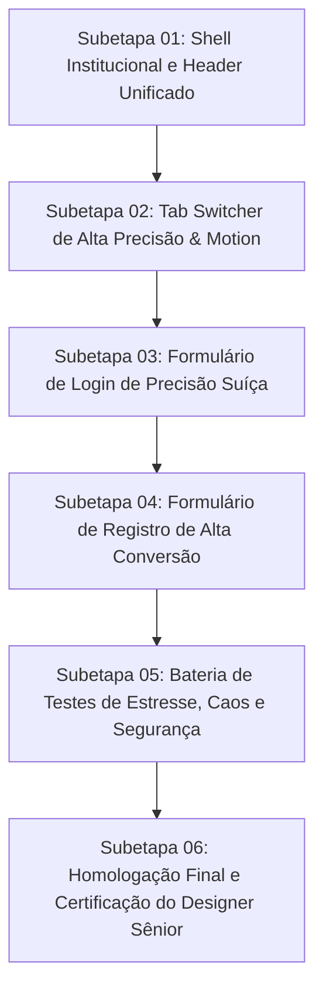

# Plano Geral — Refinamento de Design & Motion Design das Páginas de Login e Registro

> $$\mathbf{\text{“A BINMAX É UM INSTRUMENTO DE PRECISÃO, NÃO UM CASSINO.”}}$$
>
> **Diretriz de Design & Motion:** *Ambiente de Confiança Bancária Suíça. Baixa densidade, respiração visual rigorosa na escala de 8px, tipografia técnica nítida, microinterações mecânicas sob a curva `cubic-bezier(0.16, 1, 0.3, 1)` e honestidade radical de latência.*

---

## 1. Contexto e Diagnóstico Forense

A auditoria visual comparativa entre o código existente e as capturas de tela oficiais (`media_1791678155959_3c3f491a.png` e `media_1791678158678_cfc4369f.png`) revelou inconsistências críticas que conferiam aspecto amador e desalinhado à experiência de autenticação:

| Problema Identificado | Causa Raiz no Código | Impacto Visual / UX | Solução Cirúrgica |
| :--- | :--- | :--- | :--- |
| **Inconsistência de Shell** | `RegisterPage` continha `<header>` global de 60px enquanto `LoginPage` era um split cru sem header. | Salto visual brusco (Layout Shift de 60px) ao trocar entre abas Login e Registro. | Shell institucional unificado: Header global de 56px de alta precisão com telemetria para ambas as telas. |
| **Duplicação de Marca** | No Registro, o logo aparecia no header superior e se repetia no topo da coluna esquerda. | Poluição visual e amadorismo na apresentação da marca. | Logo único no header superior; coluna esquerda dedicada ao headline The Hunter e gráfico Vol 50. |
| **Espaçamentos Arbitrários** | Uso de margens e paddings caóticos (`14px`, `18px`, `22px`, `36px 32px`, `32px 28px`, `48px 56px`). | Desarmonia geométrica; elementos colados ou com vácuos desproporcionais. | Aplicação estrita da escala fixa de 8px (`4px, 8px, 12px, 16px, 24px, 32px, 48px`). |
| **Assimetria de Cards** | Container de Login com `maxWidth: 420px` e Registro com `maxWidth: 460px`. | O card "pulava" de largura horizontalmente na alternância de abas. | `maxWidth: 440px` padronizado e idêntico para ambos os formulários. |
| **Acabamento Amador de Inputs** | Alturas não padronizadas, sem anel de foco de precisão, checkboxes e select de país nativos do navegador. | Aspecto genérico de formulário HTML sem cara de plataforma de trading profissional. | Inputs padronizados em 42px, anel de foco 1px sutil, select de país institucional, checkboxes harmônicos. |
| **Ausência de Motion Design** | Trocas de aba secas, falta de microinterações táteis e feedback mecânico nos botões e inputs. | Sensação de estática pesada ou comportamento inconsistente. | Motion Tokens da BINMAX: transições de 100ms/180ms/260ms na curva `--ease`, entrada em bloco único e botões táteis (1px press). |
| **Anti-patterns de Cassino** | Risco de tremores (shake), spinners decorativos ou brilhos neons espalhafatosos. | Degradação da percepção de segurança institucional. | Blindagem anti-cassino: zero tremor, zero brilho neon, zero spinners mascarando rede. |

---

## 2. Squad de Especialistas & Alocação de Responsabilidades

| Papel | Agente Especializado | Responsabilidade Estrita | Skills Chave |
| :--- | :--- | :--- | :--- |
| **Orquestração Geral** | `tech-lead-orchestrator` | Decomposição do plano, condução dos gates, validação contínua e garantia do fluxo. | `01-project-context`, `20-conduzir-etapa` |
| **Direção de Arte & Motion** | `chief-visual-director` (`designer-senior`) | Poder de veto visual; governança das 10 Leis de Design, dos 8 Tokens de Movimento e checklist anti-cassino. | `21-designer-senior-binmax`, `12-tokens-binmax` |
| **Implementação Cirúrgica** | `frontend-realtime-agent` / `surgical-frontend-agent` | Escrita do código em `apps/web/src/**`, garantindo menor diff, preservação de contratos e zero regressão. | `17-mudanca-cirurgica`, `15-chave-sala-nova` |
| **Auditoria de Segurança** | `security-reviewer` | Validação de formulários, mascaramento de senha, proteção anti-bruteforce (lock de 5 tentativas) e sanitização. | `04-security-iam` |
| **QA, Estresse e Caos** | `qa-resilience-agent` | Criação e execução de testes unitários, testes de estresse (100 ciclos SSR, spam de cliques) e testes de caos. | `06-testing-quality`, `19-testes-de-regressao-visual` |
| **Conformidade de Marca** | `binmax-brand-agent` | Verificação dos tokens cromáticos Turbo Prata, tipografia Geist/Geist Mono e microcopy em espanhol neutro. | `12-tokens-binmax`, `13-textos-es` |

---

## 3. Arquitetura das 6 Subetapas de Execução

### Regra de Ouro da Execução
> **NUNCA AVANCE PARA A PRÓXIMA SUBETAPA SEM QUE A ANTERIOR ESTEJA 100% IMPLEMENTADA, COMPROVADA COM TESTES ROBUSTOS NO VITEST E HOMOLOGADA.**

---

## 4. Matriz Geral de Critérios de Aceite

1. **Invariante Visual**: Ambos os formulários compartilham o mesmo layout shell institucional com Header fixo e coluna 55/45.
2. **Zero Layout Shift**: A alternância entre `/login` e `/registro` não desloca o card de formulário horizontalmente nem verticalmente.
3. **Escala Geométrica de 8px**: Todos os `margin` e `padding` seguem rigorosamente a escala de `4px, 8px, 12px, 16px, 24px, 32px, 48px`.
4. **Motion Tokens**: Animações utilizam exclusivamente a curva `cubic-bezier(0.16, 1, 0.3, 1)` e tempos de `100ms`, `180ms` e `260ms`.
5. **Anti-Cassino Estrito**: Zero classes de tremor (`shake`), zero gradientes neons, zero spinners girando infinitamente sem motivo.
6. **Segurança**: Bloqueio de conta após 5 tentativas de login falhas mantido intacto com card informativo de alta precisão.
7. **Integração Funcional**: Compatibilidade 100% preservada com `AuthService`, `useRouter`, `setGuestMode`, `resetMockWallet` e rotas do sistema.
