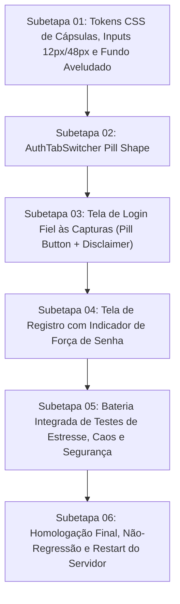

# Plano Geral — Redesign Premium Fintech das Telas de Login e Registro (Fidelidade às Novas Telas)

> **Diretriz:** *Adoção integral da nova linguagem visual de alto padrão: superfícies escuras aveludadas (#080B11, #0E131F, #121824), componentes em cápsula (Pill Shape 9999px), inputs modernos de 48px com cantos de 12px, indicador dinâmico de força de senha e disclaimer de segurança criptografada.*

---

## 1. Squad de Especialistas & Alocação de Responsabilidades

| Papel | Agente | Responsabilidade Estrita |
| :--- | :--- | :--- |
| **Liderança Técnica** | `tech-lead-orchestrator` | Condução do pipeline, gates rígidos, orquestração e homologação. |
| **Direção de Arte & Motion** | `chief-visual-director` (`designer-senior`) | Modelagem das superfícies, geometria em cápsula (pills), proporções de 12px/48px/9999px, microinterações e veto de anti-patterns. |
| **Implementação Cirúrgica** | `frontend-realtime-agent` / `surgical-frontend-agent` | Código frontend em `apps/web/src/**`, garantindo fidelidade 1:1 às capturas, mantendo contratos de autenticação intactos. |
| **QA, Estresse e Caos** | `qa-resilience-agent` | Criação de baterias Vitest de estresse (100 ciclos SSR), caos de rede, validação de regras de senha e regressão. |
| **Segurança e IAM** | `security-reviewer` | Validação do medidor de força de senha, sanitização, bloqueio de força bruta e ausência de vazamento de credenciais. |
| **Marca e Copy** | `binmax-brand-agent` | Microcopy oficial alinhado às referências com suporte a Português e Espanhol e disclaimer institucional de segurança. |

---

## 2. Diagnóstico das Novas Referências Visuais

1. **Tab Switcher em Cápsula (Pill Shape)**:
   - Cápsula externa: `height: 44px`, `border-radius: 9999px`, fundo `#0E131F`, borda `1px solid rgba(255,255,255,0.08)`, `padding: 4px`.
   - Aba ativa: `border-radius: 9999px`, fundo `#141A28`, borda `1px solid rgba(255,255,255,0.14)`, texto `#FFFFFF` peso 700.
   - Aba inativa: texto `#8A92A1` peso 500, transição suave de 100ms.
2. **Tipografia de Títulos e Subtítulos**:
   - Título Login: `Bem-vindo de volta.` (~30px, peso 800, `letter-spacing: -0.02em`).
   - Subtítulo Login: `Entre para voltar a operar de onde parou.` (~14px, `#8A92A1`).
   - Título Registro: `Abra sua conta grátis.` (~30px, peso 800, `letter-spacing: -0.02em`).
   - Subtítulo Registro: `Leva 15 segundos. Você começa na conta de prática.` (~14px, `#8A92A1`).
3. **Caixas de Texto (Inputs)**:
   - Altura: `48px`.
   - Raio de canto: `12px` (arredondamento moderno e confortável).
   - Fundo: `#121824`.
   - Borda: `1px solid rgba(255,255,255,0.08)`.
   - Padding interno: `0 16px` (ou `0 42px 0 16px` com toggle de senha).
   - Foco: anel cirúrgico em `rgba(34, 196, 122, 0.3)`.
4. **Indicador de Força de Senha no Registro**:
   - 4 barras horizontais de progresso.
   - 3 requisitos com marcadores circulares: `8+ caracteres`, `Uma letra`, `Um número` (validados dinamicamente).
5. **Botão Primário em Cápsula (Pill Button)**:
   - `border-radius: 9999px`, altura `48px`, verde vivo `#22C47A` / `#00E599`, texto preto em negrito `#08140B`, seta `→`.
6. **Disclaimer Institucional de Segurança**:
   - Ícone de cadeado verde + texto: `Conexão criptografada. A BINMAX nunca pede sua senha por WhatsApp, e-mail ou telefone.`
7. **Fundo e Atmosfera**:
   - Fundo aveludado profundo `#080B11`, gradiente radial sutilíssimo no topo, card central com cantos de `20px` e sombra suave.

---

## 3. Matriz das Subetapas

