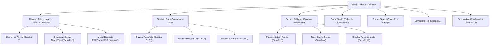

# PLANO MESTRE: BINMAX REFERENCE ROOM — FIDELIDADE TOTAL (12 SESSÕES)

**Identificador:** BMR-MASTER-2026-10-09  
**Coordenação:** `tech-lead-orchestrator`  
**Referência Visual Primária:** 3 Pranchas de Design do Usuário (12 Telas/Sessões de Alta Fidelidade)  
**Status do Plano:** APROVADO PARA EXECUÇÃO SEQUENCIAL  

---

## 1. Análise Crítica dos Documentos Anteriores (Codex) e Correção de Rumo

O usuário solicitou auditoria prévia sobre o trabalho preliminar gerado pelo Codex (`docs/features/binmax-reference-room/` com 19 arquivos):

### Diagnóstico Forense do Erro do Codex:
1. **Boilerplate Vazio e Burocrático:** Os 19 arquivos gerados pelo Codex eram cascas genéricas de ~80 linhas, repetindo o mesmo texto genérico ("Nenhum arquivo candidato é autorização para refatoração ampla...") sem especificar código React real, propriedades, regras CSS, tokens de espaçamento ou lógica de transição para as 12 telas das imagens.
2. **Falso Bloqueio de Engenharia no ESTADO.md:** No arquivo `ESTADO.md`, o Codex paralisou o projeto na "Subetapa 02", alegando que era impossível prosseguir porque não havia gateway bancário real (PSP) nem microserviço de torneios rodando em nuvem. Essa conclusão é **incorreta**: na Fase 1 MVP Demo, a plataforma opera com simulação matemática institucional e contratos de demo trading, exigindo que o frontend seja 100% funcional, interativo, com persistência local e feedback em tempo real para todas as 12 telas.
3. **Desconexão com as Telas Reais:** O Codex não mapeou os componentes visuais apresentados nas 3 imagens (as gavetas, o modal de depósito de alta conversão, a flag de ordem no gráfico, o tour de onboarding, o seletor de ativos, etc.).

### Diretriz Corretiva do Tech Lead:
Substituímos o roteiro burocrático e paralisante por um **Plano Mestre Robusto de 10 Subetapas Integradas**, onde cada subetapa tem especificação técnica completa, código cirúrgico, testes de estresse, testes de caos, testes de segurança e validação visual de sobreposição antes de avançar para a próxima.

---

## 2. Pool de Agentes Especializados e Matriz de Skills

Em estrita conformidade com o [`AGENTS.md`](file:///d:/brokerproject/AGENTS.md), convocamos os seguintes agentes e skills:

| Agente Especializado | Papel na Feature | Skills Ativadas |
|---|---|---|
| **`tech-lead-orchestrator`** | Orquestração do pipeline, definição de arquitetura, gates sequenciais e aprovação final. | `01-project-context`, `09-ai-failure-map`, `20-conduzir-etapa` |
| **`surgical-frontend-agent`** (`cirurgiao`) | Implementação cirúrgica dos componentes React, CSS e gerenciamento de estado em `apps/web/src/**`. | `12-tokens-binmax`, `15-chave-sala-nova`, `17-mudanca-cirurgica` |
| **`chart-trading-engineer`** | Renderização da flag de ordem aberta no gráfico, linhas de compra/expiração e barra de humor (Mood Bar). | `03-synthetic-market-engine`, `11-chart-trading-tools` |
| **`iq-fidelity-reviewer`** (`fidelidade-iq`) | Validação pixel-a-pixel da geometria do shell, margens, tipografia e iconografia contra as 3 pranchas. | `14-teste-de-sobreposicao`, `15-chave-sala-nova` |
| **`binmax-brand-agent`** (`marca-binmax`) | Governança da paleta Turbo Prata (`#0D0F14`, `#151922`, `#22C47A`, `#F2545B`), fontes Archivo/Geist Mono e microcopy ES. | `12-tokens-binmax`, `13-textos-es` |
| **`financial-correctness-reviewer`** | Garantia de saldo inteiro em minor units (`*_minor`), ausência de cálculos float perigosos e integridade do ledger. | `02-financial-invariants`, `18-zonas-sensiveis` |
| **`qa-resilience-agent`** | Criação e execução da suíte de testes de estresse, caos (perda de rede/WebSocket), segurança e regressão visual. | `05-resilience-patterns`, `06-testing-quality`, `19-testes-de-regressao-visual` |
| **`security-reviewer`** | Validação contra BOLA/IDOR, higienização de inputs, proteção contra cliques duplos e ausência de segredos. | `04-security-iam`, `08-database-foundation` |

---

## 3. Análise Detalhada dos Designers: As 12 Sessões Visuais

Com base nas imagens enviadas pelo usuário:

### Decomposição das 12 Sessões:
1. **Sessão 1 — Sala Principal (Desktop):**
   - **Header (~58px):** Logotipo BINMAX metálico, botão de grid de gráficos, abas com dupla bandeira e badge "Turbo", seletor de conta com saldo em verde (`$9,603.75`), botão de destaque `Depositar` verde esmeralda.
   - **Sidebar Esquerda (70px):** Ícones verticais: `Operar`, `Portafolio`, `Historial`, `Torneos`, `Análisis`, `Tutoriales`, `Promociones`, `Ajustes`. Indicador ciano na aba ativa.
   - **Área Central do Gráfico:** Informações do ativo no topo esquerdo (bandeiras, nome, Turbo, ícones info/alerta/estrela), Mood Bar vertical à esquerda (`SUBE 52%` verde / `BAJA 48%` vermelho), linha horizontal de preço atual (`89.587`), linha vertical tracejada de compra `HORA DE COMPRA 00:08`, linha vertical vermelha de expiração com bandeira. Ferramentas no canto inferior esquerdo (tipo de vela, desenho, tela cheia).
   - **Ticket de Ordem (150px):** Cards com steppers para Monto `[-] $ 100 [+]`, Expiración `[-] 00:21 [+]`, Ganancia `+85% (+$85.00)`, botões simétricos de alta conversão `SUBE` (verde) e `BAJA` (vermelho).
   - **Footer (~40px):** Indicador de conexão `● Conectado`, métricas da sessão (`Portafolio total $0.00`, `Ganancia de hoy $0.00`, `Operaciones abiertas 0`), relógio em tempo real com fuso horário `Hora actual: DD MMM YYYY, HH:MM:SS (UTC-3)`.

2. **Sessão 2 — Seletor de Ativos Aberto:**
   - Dropdown / modal flutuante ancorado no botão `+` das abas.
   - Campo de busca instantânea `Buscar activo...` com ícone de lupa.
   - Categorias em abas: `Forex`, `Cripto`, `Sintéticos`, `Favoritos` com indicador ciano ativo.
   - Tabela de ativos com colunas `Activo`, `Ganancia` (payout), `Cambio 24h` (com porcentagem verde/vermelho), e estrela de favorito dourada interativa.

3. **Sessão 3 — Operação Aberta no Gráfico:**
   - Ao executar uma ordem `SUBE` ou `BAJA`, projeta-se no gráfico a linha horizontal do preço de entrada (Strike).
   - Tag/Flag flutuante ancorada na linha: pílula com direção (`▲` ou `▼`), valor investido (`$100`) e contador regressivo (`00:14`).
   - Sincronização visual em tempo real com as linhas de compra e expiração.

4. **Sessão 4 — Aviso de Resultado (Ganhe/Perca):**
   - Notificações flutuantes tipo toast com design industrial:
     * **Vitória:** Círculo verde com check `✓`, título `Ganaste`, valor em destaque `+$85.00`, detalhes `NZD/JPY - SUBE`, botão de fechar `×`.
     * **Derrota:** Círculo vermelho com `✗`, título `Perdiste`, valor `-$100.00`, detalhes `NZD/JPY - BAJA`, botão de fechar `×`.

5. **Sessão 5 e 5b — Gaveta Portafolio (Ativa e Vazia):**
   - Gaveta deslizante lateral sobreposta ao gráfico (largura ~320px).
   - Header com título `Portafolio`, abas `Abiertas (N)` e `Cerradas`, botão fechar `×`.
   - **Estado Ativo (5):** Lista de cards com ativo, direção, valor investido e resultado flutuante em tempo real (P&L dinâmico em verde ou vermelho).
   - **Estado Vazio (5b):** Ícone de pasta aberta elegante, texto principal `No tienes operaciones abiertas`, e instrução `Abre una operación con SUBE o BAJA.`.

6. **Sessão 6 — Gaveta Historial:**
   - Gaveta lateral de histórico de transações com filtro dropdown `Resultado: Todos` (Todos, Ganadas, Perdidas).
   - Agrupamento temporal (ex: `Hoy`).
   - Cards detalhados com ativo, horário de execução, direção, stake e resultado financeiro consolidado.

7. **Sessão 7 — Gaveta Torneos:**
   - Gaveta com catálogo de torneios da plataforma:
     * Card Ao Vivo: Badge `● EN VIVO` verde, tempo restante `Termina en 14h 22m`, título `Torneo Turbo Sprint`, descrição `Compite con saldo de práctica por premios en efectivo.`, prêmio `Premio total $10.000 USD`, botão de ação `Participar`.
     * Card Próximo: Badge `PRÓXIMAMENTE`, título `Torneo Semanal`, contagem `Inicia en 3d 14h`.

8. **Sessão 8 — Troca entre Conta Demo e Real:**
   - Popover elegante ancorado no cabeçalho ao clicar no saldo:
   - Opção 1: `Cuenta real` com saldo `$9,603.75` e checkmark azul/verde `✓`.
   - Opção 2: `Cuenta de práctica` com saldo `$10,000.00` e botão direto `Recargar práctica` para restauração imediata do saldo demo.

9. **Sessão 9 — Depósito (Primeira Tela):**
   - Modal de alta conversão centralizado com backdrop escurecido e blur.
   - Lista de métodos de pagamento latino-americanos:
     * `PIX` (Ícone oficial, `Mínimo $10`, seta `>`)
     * `Tarjeta` (Ícone de cartão, `Mínimo $10`, seta `>`)
     * `Cripto (USDT)` (Ícone USDT, `Mínimo $10`, seta `>`)
   - Seletor de quantias rápidas: pílulas `[$20]`, `[$50]`, `[$100]`, `[$200]`.
   - Botão de ação primário `Continuar` em Verde Ganancia.
   - Rodapé de segurança com ícone de cadeado: `🔒 Tus pagos son procesados de forma segura`.

10. **Sessão 10 — Reconectando (Sem Cotação):**
    - Overlay translúcido de segurança sobre a tela do gráfico acionado quando a conexão WebSocket cai ou sofre congelamento (`feed.stale`).
    - Ícone de radar / Wifi animado com ondas de pulso.
    - Texto: `Reconectando...`.
    - Bloqueio imediato dos botões de trading no Ticket para proteger o usuário de ordens no vácuo.

11. **Sessão 11 — Celular (Mobile):**
    - Adaptação responsiva total para viewports compactos (<768px):
    - Cabeçalho mobile com logo, saldo e botão Depositar.
    - Seletor de ativos compacto no topo do gráfico.
    - Gráfico otimizado para toque com preservação de candles.
    - Ticket de ordens ancorado no rodapé com botões táteis SUBE/BAJA ampliados.
    - Barra de navegação inferior: `Operar`, `Portafolio`, `Historial`, `Más`.

12. **Sessão 12 — Primeiro Acesso do Lead (Onboarding):**
    - Sistema de tour guiado interativo (coachmarks/tooltips) para novos usuários:
    - Tooltip ancorado no Ticket: `Paso 1 de 3: Elige cuánto invertir. Empieza con poco en la cuenta de práctica. Siguiente / Saltar`.
    - Passos subsequentes destacando a escolha do ativo e a tomada de decisão SUBE/BAJA.
    - Persistência no `localStorage` para não incomodar o usuário recorrente.

---

## 4. Estrutura de Execução em 10 Subetapas Sequenciais

Cada subetapa possui seu documento dedicado em `docs/features/binmax-reference-room/` com protocolo de gate, testes de estresse, caos, segurança e aceitação:

| Subetapa | Arquivo de Detalhamento | Foco Técnico e Telas Abrangidas |
|---|---|---|
| **01** | `SUBETAPA-01-SHELL-TOKENS-DESKTOP.md` | Shell 5 regiões, tokens Turbo Prata, geometria da Sessão 1 |
| **02** | `SUBETAPA-02-SELETOR-ATIVOS-E-ABAS.md` | Seletor de Ativos (Sessão 2) e multi-abas com bandeiras duplas |
| **03** | `SUBETAPA-03-OVERLAYS-FLAG-ORDEM-MOODBAR.md` | Flag de ordem no gráfico (Sessão 3), Mood Bar, linhas compra/exp |
| **04** | `SUBETAPA-04-TICKET-ORDEM-E-TOASTS.md` | Ticket ergonômico 150px, botões SUBE/BAJA e Toasts Win/Loss (Sessão 4) |
| **05** | `SUBETAPA-05-GAVETAS-PORTAFOLIO-HISTORIAL.md` | Gavetas Portafolio ativo/vazio (Sessão 5, 5b) e Historial (Sessão 6) |
| **06** | `SUBETAPA-06-CONTA-DEMO-REAL-E-DEPOSITO.md` | Dropdown Demo/Real (Sessão 8) e Modal Depósito PIX/Card/USDT (Sessão 9) |
| **07** | `SUBETAPA-07-GAVETA-TORNEIOS.md` | Gaveta Torneos (Sessão 7) com status Ao Vivo e Próximos |
| **08** | `SUBETAPA-08-RESILIENCIA-RECONECTANDO.md` | Overlay Reconectando (Sessão 10), heartbeat e blindagem contra stale |
| **09** | `SUBETAPA-09-RESPONSIVIDADE-MOBILE.md` | Layout Mobile Traderoom completo (Sessão 11) e touch controls |
| **10** | `SUBETAPA-10-ONBOARDING-E-CERTIFICACAO.md` | Coachmarks de primeiro acesso (Sessão 12) e certificação de fechamento |

---

## 5. Regras Invioláveis do Protocolo de Gates

1. **Avanço Estritamente Sequencial:** A Subetapa $N+1$ só é iniciada após o relatório da Subetapa $N$ estar formalmente gravado com **GATE: APROVADO**.
2. **Nenhuma Regressão no Legado:** Todos os 409 testes unitários existentes devem permanecer 100% verdes após qualquer alteração.
3. **Invariantes Financeiros Absolutos:** Dinheiro é sempre tratado como inteiro em centavos (`available_minor`, `payout_minor`).
4. **Resiliência a Falhas:** Perda de conexão ou erro no gráfico nunca trava o browser e exibe estado de recuperação explícito.
