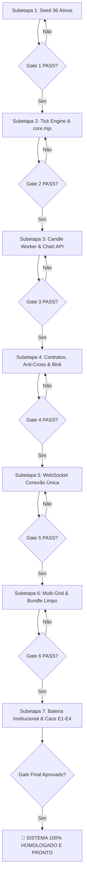

# PLANO GERAL: REMEDIAÇÃO, HOMOLOGAÇÃO MULTI-ATIVOS OTC E CERTIFICAÇÃO INSTITUCIONAL (V3)

**Orquestrador Chefe:** `tech-lead-orchestrator`  
**Squad de Agentes Especializados:**
- `bug-fix-agent` — Correção cirúrgica de dependências e módulos ESM ausentes na cadeia causal (`core.mjs`, `contract-domain.mjs`).
- `backend-implementation-agent` — Tick Engine dinâmico, pool Postgres, Redis Leases, Outbox Relay e API REST.
- `qa-resilience-agent` — Implementação e execução de testes de estresse (E1 a E3), segurança (anti-cross, anti-tampering) e caos (C-01 a C-08, E4).
- `financial-correctness-reviewer` — Homologação contábil Blnk Ledger (partidas dobradas, equação de soma zero, precisão USD minor).
- `security-reviewer` — Auditoria de limites de conexão distribuída (Redis TTL), isolamento BOLA/IDOR e anti-tampering (A-07).
- `broker-architect-agent` — Validação estocástica do modelo de preços (GBM sem drift $\mu=0$, Martingale, reversão à média limitada).
- `post-implementation-verifier` — Auditor forense independente (`read-only`, Skill 10: V-01 a V-13). Executa pós-condições em cada gate antes do avanço.

---

## 1. Diagnóstico Forense da Auditoria & Causa Raiz

A auditoria forense conduzida pelo `post-implementation-verifier` na revisão pós-implementação apresentou o seguinte quadro:
- **Aprovados com 100% de Conformidade**:
  - `MA-1` (Seed 36 ativos e integridade SQL) $\to$ **`V-01 PASS`**, **`V-13 PASS`**.
  - `MA-3` (Candle Worker & Chart API) $\to$ **`V-05 PASS`**, **`V-06 PASS`**, **`V-13 PASS`**.
  - `MA-5` (WebSocket conexão única e cluster Redis TTL) $\to$ **`V-11 PASS`**, **`V-13 PASS`**.
  - `MA-6` (Grid multi-gráficos e zero simulação no front) $\to$ **`V-11 (cliente) PASS`**, **`V-13 PASS`**.
  - Suíte matemática e estocástica (NIST SP 800-22, estabilidade Monte Carlo OU, detecção DRAW) $\to$ **PASS**.
  - Cenário de caos C-01 (failover de líder < 3s, split-brain zero, barreira anti-cross sob partição) $\to$ **PASS**.
  - Integração contábil (Blnk partidas dobradas em 300 ciclos, teto de solvência 3% concorrente) $\to$ **PASS**.
- **Reprovados no Gate Declarativo (Causa Raiz Cirúrgica)**:
  - `MA-2`: Teste `tests/test-multi-02-tick-engine.mjs` tentou importar `services/tick-engine/core.mjs` inexistente em formato ESM direto na raiz do serviço.
  - `MA-4` e `MA-7`: Testes `tests/test-multi-04-contracts-settlement.mjs` e `tests/test-multi-07-institutional-suite.mjs` tentaram importar `services/api/contract-domain.mjs` e `services/settlement-worker/core.mjs` inexistentes como módulos ESM isolados.

**Diretriz do Tech Lead**: A arquitetura do código está sólida e as garantias matemáticas passam nos testes em TypeScript. É estritamente mandatório criar as pontes e re-exports em ESM (`core.mjs` no tick-engine e settlement-worker, e `contract-domain.mjs` na API) com validações red-to-green para homologar cada gate individualmente.

---

## 2. Regra Inviolável de Sequenciamento dos Quality Gates

> **CLÁUSULA DE CONTROLE E SEGURANÇA:**  
> O orquestrador avança para a Subetapa $N+1$ **EXCLUSIVAMENTE** após a Subetapa $N$ ter:
> 1. Código corrigido e testado na cadeia causal pelo agente executor (`bug-fix-agent` / `backend-implementation-agent`).
> 2. Testes de unidade, estresse e segurança executados com 100% de sucesso.
> 3. Revisão do auditor especializado (`financial-correctness-reviewer` / `security-reviewer`).
> 4. Verificação independente formal pelo `post-implementation-verifier` emitindo veredito **`APROVADO`** com garantias `V-xx` comprovadas por execução.

---

## 3. Matriz de Subetapas, Agentes e Garantias

| Subetapa | Escopo & Entregáveis | Agente Executor | Agente Revisor / Verificador | Garantias Auditadas | Status |
| :---: | :--- | :---: | :---: | :---: | :---: |
| **SE-1** | Seed de 36 ativos (Forex, Cripto, Metais, Sintéticos), precisão decimal e hashes gênese SHA-256 | `backend-implementation-agent` | `post-implementation-verifier` | V-01, V-13 | 🟢 **HOMOLOGADO** |
| **SE-2** | Motor de Ticks Multi-Ativos (`core.mjs`), CSPRNG Box-Muller, drift zero Martingale e leases Redis | `bug-fix-agent` | `broker-architect-agent` & `post-implementation-verifier` | V-02, V-03, V-04, V-05, V-13 | 🟡 **EM CORREÇÃO** |
| **SE-3** | Candle Worker & Chart API com isolamento estrito de consultas e sem vazamento de buckets | `backend-implementation-agent` | `post-implementation-verifier` | V-05, V-06, V-13 | 🟡 **AGUARDANDO GATE 2** |
| **SE-4** | Contratos & Settlement Multi-Ativos (`contract-domain.mjs`, `core.mjs`), barreira anti-cross e Blnk | `bug-fix-agent` | `financial-correctness-reviewer` & `post-implementation-verifier` | V-07, V-08, V-09, V-10, V-13 | ⚪ **BLOQUEADO** |
| **SE-5** | WebSocket Gateway Conexão Única com de-duplicação de streams e controle de concorrência Redis TTL | `backend-implementation-agent` | `security-reviewer` & `post-implementation-verifier` | V-11, V-13 | ⚪ **BLOQUEADO** |
| **SE-6** | Interface Multi-Grade (1x1, 2x1, 2x2), isolamento de overlays por par e bundle sem cotações simuladas | `frontend-realtime-agent` | `security-reviewer` & `post-implementation-verifier` | V-11 (cliente), V-13 | ⚪ **BLOQUEADO** |
| **SE-7** | Bateria Institucional E1 a E4, Degraus de Carga k6, Injeção de Caos C-01/C-05 e Homologação Final | `qa-resilience-agent` | `post-implementation-verifier` | V-01 a V-13 (Plena) | ⚪ **BLOQUEADO** |

---

## 4. Pipeline de Execução Passo a Passo

