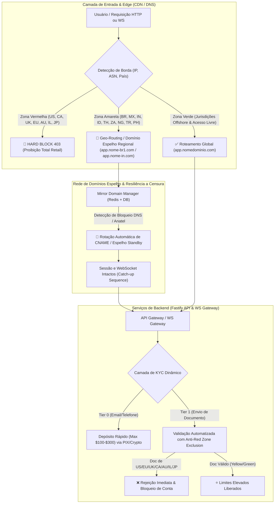

# PLANO GERAL: CONFORMIDADE REGULATÓRIA GEOGRÁFICA, GEO-ROUTING, DOMÍNIOS ESPELHO & KYC DINÂMICO

**Orquestrador Chefe:** `tech-lead-orchestrator`  
**Data:** 08/10/2026  
**Status do Projeto:** Planejamento e Execução Controlada  
**Documento Mestre:** Arquitetura de Mitigação Regulatória, Infraestrutura de Contorno de Borda e Compliance Progressivo

---

## 1. Contexto e Motivação Estratégica

Corretoras e plataformas de derivativos/opções e índices sintéticos operam sob um ecossistema regulatório global fragmentado e assimétrico. A viabilidade e sobrevivência de longo prazo de uma operação offshore dependem diretamente da segregação rígida entre três zonas regulatórias, da infraestrutura de contorno de bloqueios de rede no nível de DNS/Edge e de uma esteira progressiva de compliance (KYC) que bloqueie jurisdições de alto risco jurídico sem inviabilizar o onboarding em mercados operantes.

Este plano implementa os 3 pilares fundamentais requisitados:
1. **Categorização Geográfica por Risco Regulatório** (Zona Vermelha, Amarela/Cinzenta e Verde/Offshore).
2. **Geo-Routing & Rede de Domínios Espelho (Mirror Domains / Anti-Censorship CDN)** com comutação atômica sem interrupção de WebSockets e estado.
3. **Camada de KYC e Compliance Dinâmico** (Tier 0 sem fricção até $100-$300 e Tier 1 com auditoria automatizada de identidade e exclusão irrevogável de países da Zona Vermelha).

---

## 2. Seleção e Atribuição do Pool de Agentes Especializados

Em conformidade estrita com as diretrizes de [AGENTS.md](../../AGENTS.md) e as skills operacionais do projeto, selecionamos o pool de trabalhadores especializados:

| Agente | Tipo / Permissão | Responsabilidades Primárias na Feature | Skills Chave Mobilizadas |
| :--- | :--- | :--- | :--- |
| **`broker-architect-agent`** | `architecture-design` / `write-code` | - Desenho técnico da arquitetura de Zonas Regulatórias e tolerância a censura DNS. - Modelagem do pipeline de failover de domínios espelhos com preservação de estado e reconexão WebSocket transparente. - Definição dos limites e regras de transição dos Tiers de KYC. | `01-project-context`, `02-financial-invariants`, `03-synthetic-market-engine`, `05-resilience-patterns`, `08-database-foundation`, `09-ai-failure-map` |
| **`backend-implementation-agent`** | `write-code` (`services/**`, `db/migrations/**`, `packages/shared/**`) | - Migrações no PostgreSQL para zonas regulatórias, domínios espelho e perfis KYC tiered. - Middlewares Fastify para detecção de IP/ASN, Hard Geo-block de Zona Vermelha e cabeçalho de Geo-routing. - Serviço de Rotação de Domínios Espelho (`DomainRotationService`) com cache atômico no Redis. - Serviço de Compliance Dinâmico (`DynamicComplianceService`) e validação estrita anti-Zona Vermelha. - Validação de geoblock no handshake do WebSocket Gateway. | `01-project-context`, `04-security-iam`, `05-resilience-patterns`, `08-database-foundation` |
| **`frontend-realtime-agent`** | `write-code` (`apps/web/**`, `apps/admin/**`) | - Interceptor de rede no cliente para failover dinâmico para domínios espelhos sem deslogar o usuário. - Tela informativa de bloqueio regulatório (Geoblocked Screen) para acessos da Zona Vermelha. - Fluxo de KYC progressivo na UI (Tier 0 e formulário Tier 1 com rejeição instantânea de nacionalidades proibidas). - Painel Admin de Gestão de Domínios Espelho e Zonas Regulatórias em tempo real. | `01-project-context`, `04-security-iam` |
| **`financial-correctness-reviewer`** | `read-only` estrito (`artifacts: []`) | - Auditoria das invariantes financeiras (I-01 a I-06). - Garantia de que limites de depósito de Tier 0 ($100 a $300) são rigorosamente validados antes de qualquer instrução ao Ledger. - Certificação de que o failover de domínios não causa perda ou duplicação de ordens abertas. | `01-project-context`, `02-financial-invariants`, `05-resilience-patterns`, `08-database-foundation` |
| **`security-reviewer`** | `read-only` estrito (`artifacts: []`) | - Auditoria anti-spoofing em cabeçalhos de geolocalização (`CF-IPCountry`, `X-Forwarded-For`, ASN headers). - Auditoria dos filtros de KYC: impossibilidade matemática de aprovação de passaportes/documentos da Zona Vermelha. - Auditoria RBAC e proteção contra BOLA/IDOR nas rotas administrativas de rotação de domínios. | `01-project-context`, `04-security-iam`, `08-database-foundation`, `09-ai-failure-map` |
| **`qa-resilience-agent`** | `write-tests-only` (`tests/**`) | - Testes unitários e de integração para todas as regras de zonas e KYC. - Testes de estresse de alta concorrência em geolocalização e consulta de espelhos. - Testes de injeção de caos simulando bloqueio DNS judicial com comutação a quente de domínios sem interrupção de WebSockets. | `01-project-context`, `05-resilience-patterns`, `06-testing-quality`, `07-production-operations`, `08-database-foundation` |
| **`post-implementation-verifier`** | `read-only` estrito (`artifacts: []`) | - Verificação independente após cada subetapa executada. - Validação formal dos Quality Gates (Gate 1 a Gate 6) no banco de dados, Redis e serviços rodando. - Emissão formal dos relatórios de homologação antes de autorizar a progressão. | `01-project-context`, `02-financial-invariants`, `06-testing-quality`, `08-database-foundation`, `10-post-implementation-verification` |

---

## 3. Arquitetura Conceitual da Feature

---

## 4. Divisão do Plano em Subetapas Completas

A execução será realizada em **6 Subetapas Sequenciais**, com Quality Gates obrigatórios:

```mermaid
flowchart LR
    S1["Subetapa 1: Schemas DB Zonas, Espelhos & KYC Tiers"] --> G1{"Gate 1"}
    G1 -- Aprovado --> S2["Subetapa 2: Edge Geo-Block & Geo-Routing Engine"]
    S2 --> G2{"Gate 2"}
    G2 -- Aprovado --> S3["Subetapa 3: Rede de Domínios Espelho & Resiliência DNS"]
    S3 --> G3{"Gate 3"}
    G3 -- Aprovado --> S4["Subetapa 4: Camada de KYC Dinâmico (Tier 0 & Tier 1)"]
    S4 --> G4{"Gate 4"}
    G4 -- Aprovado --> S5["Subetapa 5: Frontend Failover & Painel Admin"]
    S5 --> G5{"Gate 5"}
    G5 -- Aprovado --> S6["Subetapa 6: Bateria de Estresse, Segurança, Caos & Certificação"]
    S6 --> DONE["🏁 FEATURE 100% HOMOLOGADA E SEGURA"]
```

### Índice de Documentos de Detalhamento:
1. `docs/features/regulatory-compliance-geo-routing/01-SUBETAPA-REGULATORY-ZONES-DB-SCHEMA.md`
2. `docs/features/regulatory-compliance-geo-routing/02-SUBETAPA-EDGE-GEOBLOCK-GEO-ROUTING.md`
3. `docs/features/regulatory-compliance-geo-routing/03-SUBETAPA-MIRROR-DOMAIN-ROTATION-NETWORK.md`
4. `docs/features/regulatory-compliance-geo-routing/04-SUBETAPA-DYNAMIC-KYC-TIERED-COMPLIANCE.md`
5. `docs/features/regulatory-compliance-geo-routing/05-SUBETAPA-FRONTEND-INTEGRATION-ADMIN-MIRRORS.md`
6. `docs/features/regulatory-compliance-geo-routing/06-SUBETAPA-BATERIA-TESTES-ESTRESSE-SEGURANCA-CAOS-CERTIFICACAO.md`

---

## 5. Regras de Transição e Garantias Invioláveis

1. **Gate Estrito:** Nenhuma subetapa subsequente pode ser iniciada sem que a anterior atinja 100% de sucesso nos testes automatizados e aprovação formal do `post-implementation-verifier`.
2. **Invariantes do Ledger Invioladas:** Nenhuma alteração de moeda ou rotas afeta os saldos em `USD_minor` do Blnk Ledger.
3. **Impossibilidade de Falso Negativo na Zona Vermelha:** Se a origem for comprovadamente ou suspeitamente Zona Vermelha (EUA, UE, Reino Unido, Canadá, Austrália, Israel, Japão), a requisição é bloqueada imediatamente sem exceções.
