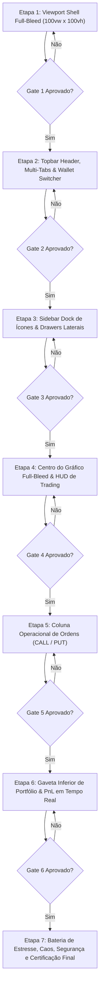

# PLANO GERAL: TERMINAL DE TRADING FULL-BLEED (100vw x 100vh)

**Arquitetura:** Terminal de Alta Performance no padrão IQ Option / Quadcode  
**Orquestrador:** `tech-lead-orchestrator`  
**Arquiteto Chefe:** `broker-architect-agent`  
**Engenheiro Frontend:** `frontend-realtime-agent`  
**Engenheiro de QA & Caos:** `qa-resilience-agent`  
**Revisores Especializados:** `financial-correctness-reviewer` & `security-reviewer`  

---

## 1. Visão Executiva e Objetivo

Transformar a interface web tradicional (`apps/web`) — atualmente formatada com container centralizado (`max-width: 1320px`, margens, barras de rolagem convencionais e rodapé estático) — em um **Trading Terminal Full-Bleed imersivo (`100vw x 100vh`, zero-scroll)** com ergonomia de mesa institucional e usabilidade estilo IQ Option / Quadcode.

### Anatomia da Viewport Fixa (100vw x 100vh)
```
┌────────────────────────────────────────────────────────────────────────────────────────┐
│ TOPBAR (48px): [Logo ∿] [Abas Ativos: SYNTH_50 +85% ✕ | EURUSD +85% ✕ | + ]    [Demo $10,000 ▼] [DEPOSITAR] │
├────┬─────────────────────────────────────────────────────────────────────┬──────────────┤
│    │ CENTRO: CHART VIEWPORT (Flex 1, Full-Bleed Canvas)                 │ DIREITA:     │
│ S  │                                                                     │ ORDER DOCK   │
│ I  │ [HUD: Velas ▼ | 1m ▼ | Indicadores]              [Sentimento 68%▲] │ (280-310px)  │
│ D  │                                                                     │              │
│ E  │                                                                     │ Tempo: 00:42 │
│ B  │                      TradingView Lightweight Charts                │ Valor: [- $10 +]│
│ A  │                         Canvas WebGL / 2D Context                   │ Presets      │
│ R  │                                                                     │ Lucro: +85%  │
│    │ ─────────────────────────────────────────────────────────────────── │ (+US$ 8,50)  │
│ (48│ Linha de Entrada da Ordem Ativa (Target & Strike)                   │ [ ▲ ACIMA ]  │
│ px)│                                                                     │ [ ▼ ABAIXO ] │
├────┴─────────────────────────────────────────────────────────────────────┴──────────────┤
│ GAVETA INFERIOR RETRÁTIL (Rodapé / Drawer): Portfólio Total (3 operações ativas) [▲ Expandir]   │
└────────────────────────────────────────────────────────────────────────────────────────┘
```

---

## 2. Squad de Agentes Especializados

| Agente | Perfil & Responsabilidade nesta Feature | Permissão |
|---|---|---|
| **`tech-lead-orchestrator`** | Coordenação geral, garantia de passagem estrita pelos Quality Gates e travas entre subetapas. | Coordenação |
| **`broker-architect-agent`** | Desenho da experiência de trading de alta frequência, sincronia de ticks com candles, HUD de timeframes e paridade visual IQ Option. | Arquitetura |
| **`frontend-realtime-agent`** | Implementação em React 19, TypeScript, CSS Grid/Flexbox full-bleed, integração com `@tradingview/lightweight-charts` e WebSocket client. | `write-code` (`apps/web/**`) |
| **`financial-correctness-reviewer`** | Validação de invariantes financeiras (`*_minor` em centavos USD, cálculo de 85% de lucro, imutabilidade contábil). | `read-only` |
| **`security-reviewer`** | Análise de sanitização de inputs, proteção contra clickjacking (`X-Frame-Options`), integridade de tokens e anti-DOM-tampering. | `read-only` |
| **`qa-resilience-agent`** | Testes de estresse a 50 ticks/s no canvas, testes de redimensionamento de viewport, testes de queda e reconexão de WebSocket. | `write-tests-only` |

---

## 3. Invariantes Arquiteturais e Regras Invioláveis

1. **Zero Viewport Scroll (`overflow: hidden` no `html, body, #root`)**: O terminal nunca deve apresentar scroll vertical ou horizontal na janela principal. Todos os painéis possuem scroll interno estritamente quando necessário.
2. **Dinheiro estritamente em Centavos Inteiros (`*_minor`)**: Nenhuma variável no frontend armazena dinheiro como `float`. Stake mínimo: `100` (US$ 1,00); Stake máximo: `10000` (US$ 100,00). Formatação exclusivamente via `formatMinor`.
3. **Idempotência no Disparo de Ordens (`crypto.randomUUID()`)**: Toda ordem gera uma chave única antes do envio e desabilita os botões imediatamente para evitar cliques duplos.
4. **Trava de 30 Segundos Pré-Expiração**: Nos últimos 30s da vela, novas ordens de compra para a vela corrente são bloqueadas com feedback visual intuitivo.
5. **Chart Auto-Resize Resiliente**: O canvas do TradingView responde instantaneamente ao `ResizeObserver` sem vazar memória, sem recriar instâncias e sem perda de ticks em trânsito.
6. **Dual Mode Transparente**: O terminal opera de maneira idêntica com o backend real (`Fastify + Keycloak + Blnk`) e no modo instantâneo Guest Demo (para demonstrações imediatas e testes offline).

---

## 4. Divisão em Subetapas Sequenciais (Execução Estrita)

O desenvolvimento segue estritamente a política de **Portões de Qualidade (Quality Gates)**: nenhuma etapa posterior será iniciada antes da anterior estar 100% implementada, testada e validada.



---

## 5. Critérios de Conclusão da Feature
- Terminal rodando a 60 FPS estáveis na porta 5173 (`apps/web`).
- Zero erros de console ou avisos de memory leak.
- Build TypeScript / Vite 100% verde sem warnings impeditivos.
- Ergonomia visual e de áudio de alta precisão aprovada pelos revisores.
