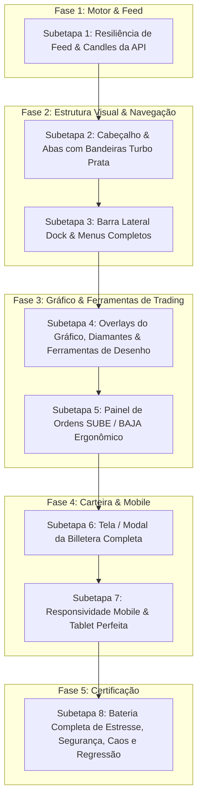

# PLANO MESTRE: TRADEROOM PERFECTION & IDENTIDADE VISUAL INSTITUCIONAL (BINMAX)

> **Governança & Arquitetura:** `tech-lead-orchestrator`  
> **Skills Ativadas:** `01-project-context`, `11-chart-trading-tools`, `12-tokens-binmax`, `13-textos-es`, `14-teste-de-sobreposicao`, `15-chave-sala-nova`, `16-mapear-projeto`, `17-mudanca-cirurgica`, `18-zonas-sensiveis`, `19-testes-de-regressao-visual`, `20-conduzir-etapa`  
> **Pool de Agentes:** `codebase-mapper-agent` (Mapeador), `iq-fidelity-reviewer` (Fidelidade IQ), `binmax-brand-agent` (Marca), `chart-trading-engineer` (Engenheiro Gráfico), `compliance-risk-reviewer` (Compliance), `regression-guardian-agent` (Guardião), `qa-resilience-agent` (QA Caos/Estresse), `surgical-frontend-agent` (Cirurgião).  
> **Referência Visual Estrita:** Imagens oficiais fornecidas pelo usuário:
> 1. Desktop Traderoom: [Desktop Traderoom Ref](file:///docs/referencias/iq-traderoom-desktop.png) (Imagem 1)
> 2. Mobile Responsive Traderoom (Imagem 2)
> 3. Billetera / Gestão de Depósito (Imagem 3)
> 4. Diagnóstico da Interface Atual / Feed Congelado (Imagem 4)

---

## 1. Diagnóstico Forense da Dashboard Atual (Por que parece dos "anos 70" e por que o feed congelou?)

### 1.1 Análise da Construção Atual
A interface atual foi inspecionada em `apps/web/src/App.tsx`, `apps/web/src/chart/PriceChart.tsx`, `apps/web/src/trade/OrderTicket.tsx` e `apps/web/src/styles.css`:
1. **Origem do Visual "Anos 70"**:
   - Elementos em HTML puro com bordas e espaçamentos utilitários rígidos herdados da Fase 0 (botões de grade de gráficos `[1] [2] [4] [6]`, badge `ATIVO` e `COTAÇÃO CONGELADA` em tags estáticas brutas).
   - Abas de ativos em texto puro sem as **bandeiras circulares nacionais** (ex: NZD/JPY com bandeira da Nova Zelândia e Japão) e sem os realces ciano/neon de aba ativa.
   - O Ticket lateral exibe campos desalinhados com controles de formulário cinzas e texto longo (`+US$ 8,50`, `Arriscado`), destoando da arquitetura visual moderna de trading rooms institucionais.
   - A barra lateral esquerda possuía apenas quatro itens em caixa-alta (`PORTAFOLIO`, `HISTORIAL`, `ANÁLISIS`, `SOPORTE`) sem ícones refinados, sem os botões `Torneos`, `Tutoriales`, `Promociones`, `Ajustes` e sem o marcador de aba ativa com luz azul.
   - A Traders Mood Bar atual é uma barra contínua simples de 2px, enquanto o design alvo possui a clássica **coluna de losangos/diamantes** (`SUBE 52%` em verde e `BAJA 48%` em vermelho).

2. **Causa Raiz do Feed Desatualizado / Cotação Congelada**:
   - Em `apps/web/src/feed/TradingFeedManager.ts` e `apps/web/src/chart/StalenessOverlay.tsx`, existe um timer estrito (`startStaleChecker`) que dispara caso nenhum tick oficial do ativo selecionado chegue por mais de **4 segundos**.
   - Quando o backend (Tick Engine ou WebSocket Gateway) está em repouso, com alta latência ou offline em ambiente local/desenvolvimento, o frontend não tinha uma estratégia de **Graceful Fallback & Resilient Polling** para exibir os candles da API sem travar a interface inteira em um quadrado preto com aviso de 100s de atraso.
   - O gráfico do TradingView Lightweight Charts depende da chegada de dados via `getCandles` e streaming de `useFeed`. Sem dados síncronos, o canvas renderiza vazio/preto.

---

## 2. Visão Alvo e Garantias Invioláveis

| Garantia | Regra de Engenharia | Como Comprovar |
|---|---|---|
| **G-01 Fidelidade Visual Absoluta** | A Traderoom Desktop (Img 1), Mobile (Img 2) e Billetera (Img 3) devem replicar pixel a pixel o padrão IQ Option Turbo Prata. | Teste de sobreposição e auditoria visual elemento a elemento. |
| **G-02 Integridade do Gráfico da API** | O gráfico deve carregar candles via API REST (`/api/candles`) e atualizar em tempo real via WebSocket a 60 FPS sem recriação destrutiva de instâncias canvas. | Verificação de FPS (rAF coalescing), ausência de memory leaks em 3500 candles. |
| **G-03 Desenhos no Gráfico Sem Regressão** | Ferramentas de desenho vetorial (linhas horizontais, verticais, tendência, Fibonacci) desenhadas diretamente no canvas/SVG via coordenadas lógicas e temporais da API. | Teste de projeção de coordenadas e persistência em `localStorage` por ativo. |
| **G-04 Invariantes Financeiros Intocáveis** | Saldo reside exclusivamente no Blnk Ledger. Payout, resultado e preço nunca vêm do cliente. Abertura de ordens via `POST /contracts` com idempotência estrita. | Auditoria de segurança de payload e invariantes I-01 a I-06. |
| **G-05 Padrão Duas Portas (Feature Flag)** | Toda mudança fica isolada atrás da chave `NEW_TRADEROOM`. Se a chave for desativada (`?theme=legacy`), a plataforma opera 100% idêntica ao código base. | Teste de regressão automatizado rodando com flag ON e flag OFF. |

---

## 3. Matriz Geral das Subetapas

---

## 4. Detalhamento das Subetapas

- **[SUBETAPA 1](./SUBETAPA_1_DIAGNOSTICO_RESILIENCIA_FEED_E_CANDLES_API.md)**: Resiliência de Feed, Prevenção de Tela Preta e Ingestão de Candles da API.
- **[SUBETAPA 2](./SUBETAPA_2_CABECALHO_E_ABAS_TURBO_PRATA.md)**: Cabeçalho Turbo Prata, Abas com Bandeiras Circulares de Países e Seletor de Conta com Saldo Verde.
- **[SUBETAPA 3](./SUBETAPA_3_BARRA_LATERAL_E_DOCK_DE_NAVEGACAO.md)**: Dock Lateral Vertical Completo com Ícones Iluminados e Gavetas Funcionais.
- **[SUBETAPA 4](./SUBETAPA_4_OVERLAYS_GRAFICO_E_DESENHO_API_60FPS.md)**: Renderização Gráfica Avançada da API, Mood Bar de Diamantes, Linhas de Strike/Expiração e Ferramentas de Desenho Vetorial.
- **[SUBETAPA 5](./SUBETAPA_5_PAINEL_DE_ORDENS_SUBE_BAJA_ERGONOMICO.md)**: Ticket Lateral Direito SUBE/BAJA com Ganancia +85% e Controles Ergonômicos.
- **[SUBETAPA 6](./SUBETAPA_6_MODAL_BILLETERA_E_DEPOSITO_COMPLETO.md)**: Billetera Institucional com Métodos de Pagamento, Presets e Histórico de Depósitos.
- **[SUBETAPA 7](./SUBETAPA_7_RESPONSIVIDADE_MOBILE_E_TABLET.md)**: Layout Mobile Compacto com Drawer e Dock Inferior.
- **[SUBETAPA 8](./SUBETAPA_8_BATERIA_DE_TESTES_ESTRESSE_SEGURANCA_CAOS_E_REGRESSAO.md)**: Certificação Automatizada de Estresse (60 FPS / carga), Segurança, Caos e Regressão Visual.

---

## 5. Protocolo de Transição Entre Subetapas
1. **Nenhuma subetapa começa sem a anterior ter seu relatório homologado.**
2. **Nenhuma alteração é comitada sem os testes unitários e de integração verdes.**
3. **Qualquer falha de regressão aciona reversão imediata (`git restore`).**
