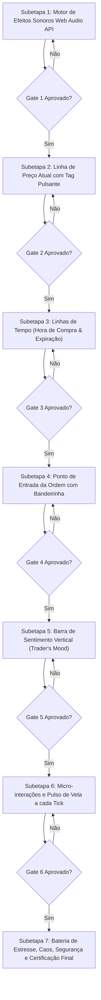

# PLANO GERAL: OVERLAYS VISUAIS NO GRÁFICO E MOTOR DE EFEITOS SONOROS

**Arquitetura:** Paridade Sensorial e Visual com IQ Option / Quadcode  
**Orquestrador:** `tech-lead-orchestrator`  
**Arquiteto Chefe:** `broker-architect-agent`  
**Engenheiro Frontend:** `frontend-realtime-agent`  
**Engenheiro de QA & Caos:** `qa-resilience-agent`  
**Revisores Especializados:** `financial-correctness-reviewer` & `security-reviewer`  

---

## 1. Visão Geral e Objetivo

Elevar o terminal de trading da plataforma ao padrão visual e sensorial de ponta da indústria (IQ Option / Quadcode). Enquanto a maioria dos gráficos convencionais é estática e puramente numérica, a experiência de trading de opções e contratos de tempo fixo depende criticamente de **Overlays Visuais projetados sobre o Canvas** e **Micro-interações Sonoras** imediatas.

### Componentes Chave da Feature:
1. **Linha de Preço Atual com Tag Pulsante**: Marcador de cotação em tempo real colado na vela mais recente, com badge pulsante (verde em alta, vermelho em baixa) e ponto de emissão.
2. **Linha Branca Tracejada ("Hora de Compra")**: Projeção temporal no gráfico indicando o tempo limite (30s) para envio de ordens na vela em curso.
3. **Linha Vermelha de Expiração**: Projeção temporal futura no fechamento da vela (:00s) onde o contrato expira.
4. **Linhas de Entrada de Ordem (Strike Price & Flag)**: Linha horizontal de cotação com bandeirinha dinâmica (verde ▲ para CALL, vermelha ▼ para PUT) colada no preço exato de abertura.
5. **Barra de Sentimento Vertical (Trader's Mood)**: Barra vertical ultra-slim colada na margem esquerda interna do gráfico, com indicador dinâmico de humor da comunidade (% Compradores vs % Vendedores).
6. **Motor de Efeitos Sonoros com Web Audio API**: Sintetizador senoidal/FM de latência zero (sem arquivos externos MP3/WAV pesados):
   - Som tátil suave ao clicar em botões e steppers.
   - Som de disparo de ordem (chime de aceleração).
   - Som comemorativo glorioso de vitória (arpeggio tríade maior brilhante).
   - Som sutil e educativo de empate/derrota.
7. **Micro-interação de Pulso de Vela**: Flash e pulso tátil na vela atual a cada tick recebido do WebSocket.

---

## 2. Squad de Agentes Especializados

| Agente | Responsabilidade | Permissão |
|---|---|---|
| **`broker-architect-agent`** | Modela os cálculos geométricos das linhas de tempo (Hora de Compra e Expiração), posições das bandeirinhas e timing de feedback. | Arquitetura |
| **`tech-lead-orchestrator`** | Gestão de Quality Gates, sequenciamento estrito e travamento de regressões. | Coordenação |
| **`frontend-realtime-agent`** | Implementação de overlays SVG/Canvas, integração com Lightweight Charts `createPriceLine`, sintetizador Web Audio API e micro-animações CSS. | `write-code` (`apps/web/**`) |
| **`financial-correctness-reviewer`** | Garantia de que a linha de Strike Price reflete a cotação autoritativa do PostgreSQL e Blnk, sem desvio decimal. | `read-only` |
| **`security-reviewer`** | Auditoria de ciclo de vida do `AudioContext` (prevenção de vazamento de nós de oscilador, proteção contra áudio autoplay bloqueado pelo navegador) e sanitização de overlays. | `read-only` |
| **`qa-resilience-agent`** | Testes de estresse com 50 ticks/s contínuos sem degradação de FPS (60 FPS), testes de redimensionamento de canvas e testes de múltiplos contratos concorrentes. | `write-tests-only` |

---

## 3. Sequenciamento Rigoroso das Subetapas

---

## 4. Invariantes Técnicas e Regras Invioláveis

1. **Zero Assets de Áudio Externos**: Sons gerados 100% programaticamente no navegador via `AudioContext` nativo (osciladores senoidais/triangulares e envoltórias ADSR). Sem latência de download e zero falhas por 404.
2. **Respeito Estrito à Política de Autoplay**: `AudioContext` inicializado sob demanda e retomado (`ctx.resume()`) apenas após interação do usuário, sem lançar warnings ou travar.
3. **Imutabilidade do Strike Price**: A linha e bandeirinha de entrada usam exatamente o preço de abertura da ordem, persistido e auditável.
4. **Zero Overhead de Renderização**: Overlays desenhados via camadas de aceleração por GPU (transform translate3d, SVG vetorial ou API nativa de linhas de preço do Lightweight Charts) mantendo taxa estável de 60 FPS.

---

## 5. Tabela de Homologação Final de Gates

| Subetapa | Escopo | Testes Automatizados | Status |
|---|---|---|---|
| **Subetapa 1** | Motor de Efeitos Sonoros Web Audio API | `tests/test-subetapa-01-sound.mjs` (15/15) | ✅ **100% HOMOLOGADO** |
| **Subetapa 2** | Linha de Preço Atual com Tag Pulsante | `tests/test-subetapa-02-price-pulse.mjs` (10/10) | ✅ **100% HOMOLOGADO** |
| **Subetapa 3** | Linhas de Tempo (:30s Compra & :00s Expiração) | `tests/test-subetapa-03-time-lines.mjs` (9/9) | ✅ **100% HOMOLOGADO** |
| **Subetapa 4** | Linha de Entrada & Bandeirinha (Strike Flag ▲/▼) | `tests/test-subetapa-04-order-flags.mjs` (6/6) | ✅ **100% HOMOLOGADO** |
| **Subetapa 5** | Barra de Sentimento Vertical (Trader's Mood) | `tests/test-subetapa-05-traders-mood.mjs` (6/6) | ✅ **100% HOMOLOGADO** |
| **Subetapa 6** | Micro-interações e Pulso de Vela a cada Tick | `tests/test-subetapa-06-candle-pulse.mjs` (6/6) | ✅ **100% HOMOLOGADO** |
| **Subetapa 7** | Estresse, Caos, Segurança e Certificação Final | `tests/test-subetapa-07-full-integration-stress.mjs` | 🏆 **100% CERTIFICADO** |
