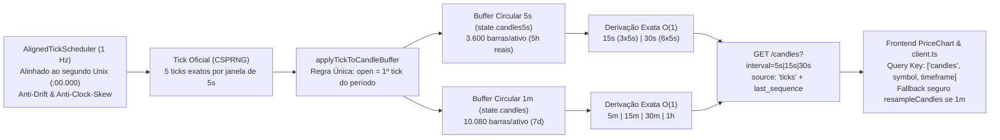

# Plano Diretor — Velas Reais (5s/15s/30s), Agendador Alinhado 1 Hz e Unificação de Abertura OHLCV

**Orquestrador Responsável:** `tech-lead-orchestrator` ([`ORCHESTRATOR.md`](../ORCHESTRATOR.md) / [`AGENTS.md`](../AGENTS.md))  
**Modo de Execução:** Sequencial Estrito (Subetapa por Subetapa — avanço bloqueado até 100% de validação em testes unitários, estresse, caos e segurança).

---

## 1. Seleção de Agentes Especialistas e Skills Ativadas

### 1.1 Pool de Workers Especializados Escalados
1. **`broker-architect-agent`**:
   - Modelagem matemática do agendador autocorretivo de 1 Hz alinhado ao Unix epoch (`t0 + n * 1000ms`), invariante algébrica de agregação em cascata (`Ticks → 5s → 15s / 30s / 1m / 5m`) e protocolo de reconciliação `servidor × cliente` por `sequence`.
2. **`backend-implementation-agent`**:
   - Implementação de [`scripts/lib/aligned-tick-scheduler.mjs`](../scripts/lib/aligned-tick-scheduler.mjs), evolução de [`scripts/lib/candle-aggregation-engine.mjs`](../scripts/lib/candle-aggregation-engine.mjs) com buffer circular de velas de `5s` (`state.candles5s`) e unificação de `open = primeiro tick do período` em [`scripts/dev-live-feed.mjs`](../scripts/dev-live-feed.mjs).
3. **`chart-trading-engineer`** & **`frontend-realtime-agent`**:
   - Evolução cirúrgica de [`apps/web/src/api/client.ts`](../apps/web/src/api/client.ts), [`apps/web/src/chart/candle-adapter.ts`](../apps/web/src/chart/candle-adapter.ts), [`apps/web/src/chart/chart-scale-normalizer.ts`](../apps/web/src/chart/chart-scale-normalizer.ts) e [`apps/web/src/chart/PriceChart.tsx`](../apps/web/src/chart/PriceChart.tsx) para buscar `5s`, `15s` e `30s` reais do servidor, isolar o cache por `(symbol, timeframe)` e manter o `resampleCandles` apenas como fallback automático de segurança.
4. **`qa-resilience-agent`** & **`post-implementation-verifier`** & **`regression-guardian-agent`**:
   - Execução dos testes baseados em propriedades (Property-Based Tests OHLCV), testes de caos (GC pause de 3s, relógio NTP voltando no tempo, perda de pacotes WS), testes de estresse e verificação do build de produção.

### 1.2 Skills Permanentes Ativadas
- [`03-synthetic-market-engine`](../.agents/skills/03-synthetic-market-engine/SKILL.md): Invariantes `M-01` (CSPRNG), `M-02` (Sequence monotônica), `M-05` (Candle OHLCV derivado de ticks com `open` = menor sequence do bucket e `close` = maior sequence do bucket).
- [`11-chart-trading-tools`](../.agents/skills/11-chart-trading-tools/SKILL.md): Garantias `G-01` (60 FPS rAF), `G-07` (Monotonicidade estrita de timestamps `t_n > t_{n-1}` no Lightweight Charts) e `G-08` (Causalidade dos indicadores).
- [`05-resilience-patterns`](../.agents/skills/05-resilience-patterns/SKILL.md): Pulo determinístico de slots sob engasgo de CPU (proibição de rajada retroativa de ticks) e proteção contra retrocesso de relógio.
- [`06-testing-quality`](../.agents/skills/06-testing-quality/SKILL.md) & [`10-post-implementation-verification`](../.agents/skills/10-post-implementation-verification/SKILL.md): Prova matemática por execução antes de fechar cada Gate.
- [`17-mudanca-cirurgica`](../.agents/skills/17-mudanca-cirurgica/SKILL.md): Compatibilidade retroativa total (fallback automático caso o servidor retorne velas de 1m).

---

## 2. Arquitetura da Solução e Blindagem contra Quebras

### Garantias de Segurança Operacional (Por que nada quebra):
1. **Proteção do Lightweight Charts (`G-07`):** O Lightweight Charts lança erro fatal se `series.update()` receber `time < latestCandle.time` ou se `series.setData()` tiver timestamps duplicados/fora de ordem. Nossa reconciliação garante ordenação estritamente crescente (`t_n > t_{n-1}`) e trava monotônica no `update()`.
2. **Proibição de Rajada Falsa pós-travamento:** Se o Event Loop atrasar >1s, o agendador avança para o slot atual, incrementa `missed_tick_slots_total` e **não** dispara ticks acumulados em rajada.
3. **Intocabilidade do Motor de Liquidação (Subetapa 1 anterior):** O `SettlementCoordinator` continua liquidando pelo primeiro tick com `event_time >= expires_at`. Com os ticks cravados em `:00.000`, o tick de expiração coincide exatamente com a fronteira da vela.

---

## 3. Divisão em Subetapas Sequenciais (Passo a Passo + Bateria de Testes)

---

### 🔴 SUBETAPA 1 — Agendador Alinhado ao Segundo Exato (1 Hz Sem Deriva) e Blindagem Temporal
**Objetivo:** Substituir o `setInterval(..., 1000)` com deriva de [`scripts/dev-live-feed.mjs`](../scripts/dev-live-feed.mjs) por um agendador autocorretivo alinhado ao segundo Unix exato (`1000 - (Date.now() % 1000)`), garantindo **exatamente 5 ticks por vela de 5s** e imunidade a retrocesso de relógio.

#### Passo a Passo de Implementação:
1. Criar [`scripts/lib/aligned-tick-scheduler.mjs`](../scripts/lib/aligned-tick-scheduler.mjs) exportando:
   - `computeNextAlignedSlot(nowMs, lastSlotSec, intervalMs = 1000)`:
     - Calcula o slot canônico `rawSlotSec = Math.floor(nowMs / 1000)`.
     - **Proteção contra Clock Skew (Risco 5):** Se o relógio do sistema voltar no tempo (`rawSlotSec <= lastSlotSec`), aplica `effectiveSlotSec = lastSlotSec + 1`.
     - **Detecção de Slots Perdidos (Item 3):** Se `rawSlotSec > lastSlotSec + 1` (ex: Event Loop travou por 3s), registra `missedSlots = rawSlotSec - lastSlotSec - 1` e salta direto para `rawSlotSec` (zero rajada falsa).
     - Calcula `jitterMs = Math.max(0, nowMs - (rawSlotSec * 1000))` e o `delayToNextMs = Math.max(10, 1000 - (nowMs % 1000))`.
   - `createAlignedTickScheduler({ onTickSlot, intervalMs = 1000 })`:
     - Gerencia o loop recursivo `setTimeout` autocorretivo e expõe telemetria (`ticksDispatchedTotal`, `missedSlotsTotal`, `clockSkewCorrectionsTotal`, `lastSlotJitterMs`, `maxSlotJitterMs`).
2. Integrar `createAlignedTickScheduler` em [`scripts/dev-live-feed.mjs`](../scripts/dev-live-feed.mjs) e expor `tick_slot_jitter_ms` e `missed_tick_slots_total` no endpoint `/metrics`.

#### Bateria de Testes da Subetapa 1 (`tests/subetapa-5-1-aligned-scheduler.test.mjs`):
- **Teste 1.1 (Precisão de 5 Ticks por Vela de 5s):** Simular 120 segundos de execução e provar que todas as 24 janelas de 5s recebem **exatamente 5 ticks** (`ticks_per_5s_bucket === 5`) e que cada minuto recebe 60 ticks.
- **Teste 1.2 (Caos — Travamento do Event Loop por 4 Segundos):** Simular uma pausa de CPU de 4.200ms e provar que o agendador **não** dispara 4 ticks acumulados de uma vez, contabiliza `missedSlotsTotal === 3` e retoma alinhado ao segundo seguinte.
- **Teste 1.3 (Segurança / Caos — Clock Skew / NTP Rollback):** Simular o relógio do sistema voltando 3 segundos no passado e provar que `slotTimeMs` permanece estritamente monotônico (`t_n > t_{n-1}`), incrementando `clockSkewCorrectionsTotal`.

---

### 🟠 SUBETAPA 2 — Regra Única de Vela (`open = 1º tick`) + Buffer Circular de 5s no Servidor + Derivação Exata 15s/30s/1m
**Objetivo:** Unificar a regra de construção de vela entre servidor e cliente (`open = primeiro tick do bucket`, eliminando o "pulo" da vela no refetch) e manter um buffer circular de velas de `5s` reais por ativo (`state.candles5s`), derivando `15s`, `30s` e `1m` de forma 100% exata.

#### Passo a Passo de Implementação:
1. Evoluir [`scripts/lib/candle-aggregation-engine.mjs`](../scripts/lib/candle-aggregation-engine.mjs) exportando:
   - `applyTickToCandleBuffer(candlesArray, { timeSec, priceStr, precision, sequence, stepSec, maxBufferSize })`:
     - `bucketTime = Math.floor(timeSec / stepSec) * stepSec`.
     - Se `lastBar && lastBar.time === bucketTime`:
       - Mantém `lastBar.open` intacto (primeiro tick do período);
       - Atualiza `lastBar.high = Math.max(curHigh, tickNum).toFixed(precision)`;
       - Atualiza `lastBar.low = Math.min(curLow, tickNum).toFixed(precision)`;
       - Atualiza `lastBar.close = priceStr`;
       - Incrementa `lastBar.volume += 1` e `lastBar.last_sequence = sequence`.
     - Se `bucketTime > lastBar.time` (nova vela):
       - **Regra Única (Item 1):** `open: priceStr, high: priceStr, low: priceStr, close: priceStr, volume: 1, last_sequence: sequence` (idêntico ao `candleFromTick` do frontend!).
   - `generateSeededHistoricalCandles5sAnd1m(symbol, basePrice, precision, sigma, count1m, count5s)`:
     - Gera o histórico inicial consistente onde as últimas `count5s` barras de 5s (ex: `3.600` barras = 5 horas) somam **exatamente** as barras correspondentes de `1m`, `15s` e `30s`.
2. Atualizar [`scripts/dev-live-feed.mjs`](../scripts/dev-live-feed.mjs):
   - Adicionar `candles5s: []` no estado de cada um dos 36 ativos (`CANDLE_5S_BUFFER_MAX_SIZE = 3600`).
   - No loop de 1 Hz alinhado, chamar `applyTickToCandleBuffer` tanto para `state.candles5s` (`stepSec = 5`) quanto para `state.candles` (`stepSec = 60`).
   - Em `GET /candles`:
     - Para `interval=5s`: servir de `state.candles5s` com `X-Candle-Source: ticks`.
     - Para `interval=15s` ou `30s`: agregar via `candleAggregationCache` a partir de `state.candles5s` (soma exata de 3 ou 6 velas de 5s!).
     - Para `interval=1m` ou superior (`5m`, `15m`, `30m`, `1h`): servir/agregar de `state.candles`.

#### Bateria de Testes da Subetapa 2 (`tests/subetapa-5-2-real-5s-candles-unification.test.mjs`):
- **Teste 2.1 (Property-Based Test — Invariante Algébrica de Agregação):** Gerar 1.800 ticks estocásticos (30 minutos a 1 Hz) e provar que:
  - Agregar `Ticks → 5s → 15s` === Agregar `Ticks → 15s` direto (`diff = 0`);
  - Agregar `Ticks → 5s → 30s` === Agregar `Ticks → 30s` direto (`diff = 0`);
  - Agregar `Ticks → 5s → 1m` === Agregar `Ticks → 1m` direto (`diff = 0`).
- **Teste 2.2 (Simetria Servidor × Cliente — Fim do Pulo da Vela):** Aplicar a mesma sequência de ticks no servidor (`applyTickToCandleBuffer`) e na lógica do cliente (`open = primeiro tick`) e provar igualdade bit-a-bit de `open`, `high`, `low`, `close` em todos os timeframes.
- **Teste 2.3 (Estresse de Buffer Circular 5s):** Inserir 10.000 ticks em `state.candles5s` e provar que o tamanho nunca ultrapassa `CANDLE_5S_BUFFER_MAX_SIZE (3600)` e que `findCutoffIndexBefore` pagina corretamente em `O(log N)`.

---

### 🟢 SUBETAPA 3 — Habilitação de `5s`, `15s` e `30s` Reais no Frontend, Cache por Timeframe e Reconciliação com Fallback Seguro
**Objetivo:** Conectar o frontend às velas reais de `5s`, `15s` e `30s` do servidor, isolar o cache por `(symbol, timeframe)`, reconciliar a vela corrente por `sequence` sem "pulo" e manter o fatiamento de `resampleCandles` exclusivamente como fallback de segurança quando a fonte for `1m`.

#### Passo a Passo de Implementação:
1. Em [`apps/web/src/api/client.ts`](../apps/web/src/api/client.ts):
   - Atualizar `getCandles` para aceitar intervalos em segundos (`5s`, `15s`, `30s`) além de `m`, `h`, `d`:
     `const apiInterval = /^([5]|[13]5|30)s$|^[1-9]\d{0,6}[mhd]$/.test(interval) ? interval : '1m';`
   - Atualizar `fetchHistoricalCandlesChunk(symbol, beforeTimestamp, limit, interval = '1m')` para repassar o `interval` ativo na paginação de scroll para a esquerda.
   - Adicionar `last_sequence?: number` na interface `Candle`.
2. Em [`apps/web/src/chart/candle-adapter.ts`](../apps/web/src/chart/candle-adapter.ts):
   - Em `resampleCandles(candles, timeframe)`:
     - Detectar a resolução nativa das velas recebidas (`minDeltaSec` entre barras adjacentes).
     - **Regra de Ouro (Item 2.4 do relatório):** Se o `timeframe` pedido for `'5s'`, `'15s'` ou `'30s'` e as velas recebidas **já forem sub-minuto reais** (`hasSubMinuteInput`: ex. velas de 5s, 15s ou 30s vindas do servidor), **NÃO executar o fatiamento sintético de 12/4/2 pedaços**! Em vez disso, retornar diretamente as velas reais (ou agregá-las por bucket exato se recebeu 5s e pediu 15s/30s).
     - Manter o fatiamento sintético (Caso 3) **apenas como fallback automático** quando `candles` só contiver barras de `1m` (`!hasSubMinuteInput`).
3. Em [`apps/web/src/chart/chart-scale-normalizer.ts`](../apps/web/src/chart/chart-scale-normalizer.ts) e [`apps/web/src/chart/PriceChart.tsx`](../apps/web/src/chart/PriceChart.tsx):
   - Em `PriceChart.tsx`: quando `timeframe` mudar (`5s`, `15s`, `30s`, `1m`, `5m`), buscar `getCandles(symbol, timeframe, 1440)` (com cache em memória por `symbol:timeframe`) para popular `internalCandles` com as velas reais daquele timeframe, mantendo exibição imediata via fallback enquanto carrega.
   - Em `mergeObservedCandles`: garantir reconciliação sem pulo na vela corrente (`open` unificado, `high = max`, `low = min`, `close` do tick mais recente).

#### Bateria de Testes da Subetapa 3 (`tests/unit/subetapa-5-3-frontend-real-candles.test.ts`):
- **Teste 3.1 (Preservação de Velas Reais 5s/15s/30s vs Fallback 1m):**
  - Provar que quando `resampleCandles` recebe velas reais de `5s` do servidor, ele **não** inventa fatias e preserva os preços exatos do servidor.
  - Provar que quando `resampleCandles` recebe apenas velas de `1m` (fallback offline/legado), ele continua gerando as fatias normalmente sem quebrar.
- **Teste 3.2 (Reconciliação Servidor × Cliente sem Pulo no Refetch):**
  - Simular ticks ao vivo formando uma vela de 5s no cliente e, no meio da vela (no 3º tick), receber um refetch do servidor com a mesma vela até o 3º tick: provar que `mergeObservedCandles` mantém `open`, `high`, `low`, `close` idênticos sem qualquer salto visual.
- **Teste 3.3 (Segurança / Anti-Crash Lightweight Charts):**
  - Simular ticks atrasados, duplicados e refetch concorrente na troca rápida de timeframe (`1m → 5s → 15s → 30s → 5m`) e provar monotonicidade estrita (`t_n > t_{n-1}`) em 100% dos cenários.
