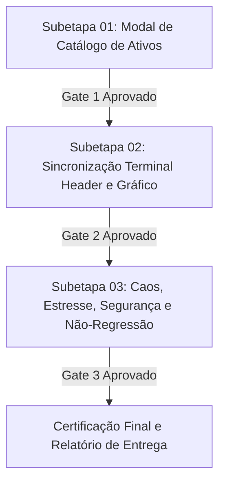

# Plano Geral: Migração de "Turbo" para "Digital" no Ecossistema de Ativos da Plataforma

> **Orquestrador**: `tech-lead-orchestrator`  
> **Comitê de Especialistas**:
> - `surgical-frontend-agent` (`cirurgiao`) — Implementação cirúrgica com menor diff possível.
> - `chief-visual-director` (`designer-senior`) & `binmax-brand-agent` — Governança visual, tipografia e proporções.
> - `compliance-risk-reviewer` & `financial-correctness-reviewer` — Integridade financeira e invariantes de produto.
> - `qa-resilience-agent` — Testes unitários, de estresse, caos e regressão.
> - `security-reviewer` — Sanitização de entradas e blindagem contra injeções.
> - `regression-guardian-agent` — Garantia de zero efeitos colaterais.

---

## 1. Visão Geral e Justificativa da Feature
A plataforma apresentava em pontos de interface o rótulo legado "Turbo" (especialmente no cabeçalho do catálogo de ativos "Catálogo de Activos · Opciones Turbo", nos badges de cada par da lista e nas abas de ativos do terminal).
Conforme a solicitação e imagem de referência oficial, a denominação de produto deve ser padronizada para **"Digital"** ("Opciones Digitales"), mantendo total harmonia com o padrão da IQ Option e da BINMAX, preservando com rigor absoluto a lógica financeira, payouts, feeds e contratos subjacentes.

---

## 2. Divisão em Subetapas e Critérios de Transição Estrita (Gates)

### Regra de Ouro do Orquestrador:
**Nenhuma subetapa é iniciada antes que a anterior esteja 100% implementada, testada, validada e com seus critérios de aceite integralmente satisfeitos.**

---

## 3. Resumo das Subetapas

### Subetapa 01: Migração do Modal de Catálogo de Ativos
- **Arquivo Alvo**: `apps/web/src/components/modals/AssetCatalogModal.tsx`
- **Alterações**:
  - Cabeçalho: `Catálogo de Activos · Opciones Digitales`
  - Badges na listagem: de `Turbo` para `Digital`
- **Validação**: Testes em `apps/web/src/trade/asset-catalog-modal.unit.test.tsx`

### Subetapa 02: Sincronização do Terminal Header e Seletor do Gráfico
- **Arquivos Alvo**:
  - `apps/web/src/components/header/TerminalHeader.tsx` (subtítulo da aba de ativo: `Digital`)
  - `apps/web/src/chart/PriceChart.tsx` (badge superior esquerda no chart: `Digital`)
  - `apps/web/src/components/sidebar/SidebarDock.tsx` (título educacional: `Opciones Digitales`)
- **Validação**: Testes de tabs e seletores in-chart.

### Subetapa 03: Bateria de Caos, Estresse, Segurança e Não-Regressão
- **Arquivo Alvo**: `apps/web/src/trade/subetapa-03-asset-catalog-digital-caos-seguranca.unit.test.tsx`
- **Cenários**: Estresse de filtragem rápida, sanitização contra ataques XSS no input de busca, invariantes de payout e parâmetros de contrato, caos de múltiplos ciclos abre/fecha e suíte global.
